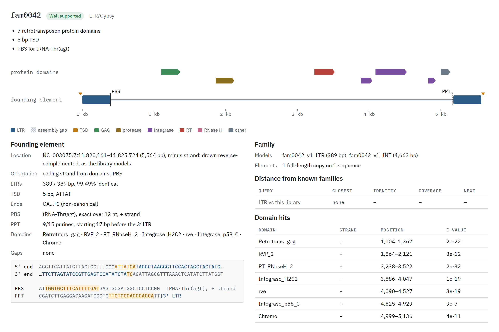

# ltr-forage

Finds LTR retrotransposon copies in a genome assembly and clusters them into a
compact library of families.

## Overview

### Finding copies: `ltr-forage`

**ltr-forage** finds long-terminal-repeat (LTR) retrotransposons with the
search algorithm of [LTRharvest](https://github.com/genometools/genometools)
(Ellinghaus, Kurtz and Willhoeft), reimplemented on the
[sufr](https://github.com/TravisWheelerLab/sufr) suffix-array index.  It also
does the work LTRharvest leaves to other tools:

- masks tandem arrays from the search, with a port of Gene Myers' FasTAN;
- refines each element's LTR boundaries;
- gathers the evidence each element carries: protein domains, target site
  duplication (TSD), TG..CA ends, and a primer binding site (PBS) matched to
  the genome's own tRNA genes.

It writes a table of every candidate with the evidence behind each call, and
the kept elements as FASTA.

With `--ltrharvest` it runs LTRharvest's search alone and writes LTRharvest's
output format, as a drop-in replacement in existing pipelines.  On hg38 with
LTRharvest's default parameters both report 41,665 candidates: 41,264 agree in
every coordinate, 254 share outer boundaries but differ inside, 133 differ in
position, and 14 on each side appear in only one output (see
[Comparing with GenomeTools LTRharvest on hg38](#comparing-with-genometools-ltrharvest-on-hg38)).

ltr-forage streams the suffix and LCP arrays from the index file rather than
loading them, so its memory scales with the genome, not the index: searching
the 3.2 Gb hg38 genome needs about 4.4 GB.  The seed search and the
per-candidate steps run in parallel.

### Building a library: `ltr_library.py`

The library driver, `ltr_library.py`, runs ltr-forage and turns the kept
elements into a family library: one LTR and one internal model per family,
cleaned of nested insertions and segmental duplications, each turned to its
element's coding strand.  It can also write an evidence page with one dossier
per family.


The numbered boxes are the steps ltr-forage (1-11) and the library driver
(12-24) name in their logs.


## Installation

### Installing a release

Each [release](https://github.com/Dfam-consortium/ltr-forage/releases) has an
archive for Linux (x86_64) and macOS (Apple Silicon):

```bash
tar -xzf ltr-forage-0.1.0-x86_64-unknown-linux-gnu.tar.gz
export PATH=$PWD/ltr-forage-0.1.0/bin:$PATH          # tcsh: set path = ($cwd/ltr-forage-0.1.0/bin $path)
ltr-forage --version
```

The archive holds `bin/ltr-forage`, `bin/ltr_library.py` (a link to
`pipeline/ltr_library.py`), the driver's step scripts in `pipeline/`, the
protein profiles and scoring matrices in `data/`, and the example in
`examples/`.  The tree can be moved anywhere: each program finds `data/`
relative to itself.  The programs below are not included.

### Prerequisites

For `ltr-forage`:

- `sufr` 0.7.12, to build the `.sufr` index
  ([TravisWheelerLab/sufr](https://github.com/TravisWheelerLab/sufr)).
  sufr 0.8.0 writes a new index format that this release cannot read.
- `nail` ≥ 0.7.1 ([TravisWheelerLab/nail](https://github.com/TravisWheelerLab/nail))
  and MMseqs2 (`mmseqs`), for the protein-domain search; not needed with
  `--no-domains` or `--ltrharvest`.  The profiles ship in `data/TEdomains.hmm`.

For the library driver, `ltr_library.py`, also:

- Python ≥ 3.8 with numpy.
- The Rust port of RMBlast, `rmblastn` ≥ 3.0.9
  ([Dfam-consortium/rmblast](https://github.com/Dfam-consortium/rmblast)); 3.0.11
  or later is recommended.  NCBI's C++ `rmblastn` does not take the options the
  driver uses.
- `te-composer` ≥ 0.6.6, from dfam-curator, for the consensus models.

To build from source: a recent stable Rust toolchain
([rustup](https://rustup.rs) recommended).

### Building from source

```bash
git clone https://github.com/Dfam-consortium/ltr-forage.git
cd ltr-forage
make                               # the binary is target/release/ltr-forage
make install PREFIX=$HOME/opt      # optional: the release layout in $HOME/opt/ltr-forage-<version>/
```

The build fetches libsufr and rmblast-lib from GitHub, at the versions pinned
in `Cargo.toml`.  `ltr-forage --version` names the commit the binary was built
from, with `-dirty` when the source had uncommitted changes.

### Finding the programs

Neither program has built-in install locations.  Each program is taken from
its option, else its environment variable, else `PATH`:

| Program | Option | Environment variable |
|---|---|---|
| ltr-forage | `--ltr-forage` | `LTRFORAGE` |
| sufr (only when the driver builds the index) | `--sufr-bin` | `SUFR` |
| rmblastn (the Rust port) | `--rmblastn` | `RMBLASTN` |
| te-composer | `--te-composer` | `TE_COMPOSER` |
| nail | `--nail` | `NAIL` |
| MMseqs2 | `--mmseqs` | `MMSEQS` |

`ltr-forage` itself uses only nail and MMseqs2 (`--nail`, `--mmseqs`).  The
driver checks versions, skips a program that is too old, and says which one it
skipped when none qualifies.  It writes the path and version of every program
it used to `run.log`.  For example, with the programs in `/opt/tools`:

```bash
export NAIL=/opt/tools/nail/nail MMSEQS=/opt/tools/mmseqs/bin/mmseqs        # bash
setenv NAIL /opt/tools/nail/nail; setenv MMSEQS /opt/tools/mmseqs/bin/mmseqs  # tcsh
```


## Quick start

With the programs installed and findable (to try a small genome first, see the
[example](#example-arabidopsis-chromosome-4)):

**1. Index the genome, once.**

```bash
sufr create --dna -o genome.sufr genome.fa
```

sufr needs scratch space in `$TMPDIR` (`/tmp` when unset) up to the size of the
finished index, about 9 bytes per genome base.  Do not pass `--ignore-softmask`
on a soft-masked assembly: it turns lowercase bases into N rather than
uppercasing them, which removes the repeats you are looking for.

**2. Find the copies.**

```bash
ltr-forage genome.sufr -t 24 --library elements.fa --fastan-out tandem.bed \
    --log ltr-forage.log > cand.tsv
```

**3. Or build a family library**, with the evidence page:

```bash
ltr_library.py genome.fa -o out -t 24 --evidence-page
```

The driver runs ltr-forage itself, with the same settings as step 2, and uses
`genome.sufr` when it sits beside the genome (otherwise it builds the index).

**LTRharvest's search only:**

```bash
ltr-forage genome.sufr --ltrharvest -t 24 > ltrharvest.out
```

What each file holds is under [Output](#output).


## Example: Arabidopsis chromosome 4

`examples/ath_chr4.fa.gz` is chromosome 4 of *Arabidopsis thaliana*
(TAIR10.1, NCBI RefSeq NC_003075.7): 18.6 Mb, with a pericentromere full of
Gypsy and Copia elements.  The whole example takes about five minutes on 8
threads.  Run it in an empty directory (from a source checkout, use
`target/release/ltr-forage` and `pipeline/ltr_library.py`):

```bash
gzip -dc /path/to/ltr-forage/examples/ath_chr4.fa.gz > ath_chr4.fa
sufr create --dna -o ath_chr4.sufr ath_chr4.fa                  # 2 s, 167 MB
```

**Copies only.**  ltr-forage writes the candidate table, the kept elements and
the masked tandem arrays in under a minute.  The screen (stderr) shows each
stage as it starts and a summary at the end:

```bash
ltr-forage ath_chr4.sufr -t 8 --library elements.fa --fastan-out tandem.bed \
    --log ltr-forage.log > cand.tsv
```

```
[15:03:21] ltr-forage ath_chr4.sufr -t 8 --library elements.fa --fastan-out tandem.bed --log ltr-forage.log
[15:03:21] Index and Tandem-Array Mask (stages 1-2)
[15:03:21]   1 sequence(s), 18.6 Mb
[15:03:28]   2,729 tandem array(s) masked (0.8 Mb)
[15:03:28] Candidate Detection (stages 3-7)
[15:03:46]   823 candidate element(s) from 3,470 seed pair(s)
[15:03:46] Evidence (stage 8)
[15:04:08]   230 with a protein domain hit (154 LTR order), 34 with a PBS, 82 with a TSD, 30 with TG..CA ends
[15:04:08] Decision and Output (stages 9-11)
[15:04:08] Results
[15:04:08]   116 LTR retrotransposon element(s) kept of 823 candidate(s)
[15:04:08]   rejected: 76 non-LTR protein hits, 54 LTR self-repeat, 9 domain inside an LTR, 0 poly-A-tailed LTRs, 35 overlapping a call with more evidence, 533 too little evidence
[15:04:08]   output: candidate table on stdout, elements.fa, tandem.bed
[15:04:08] done: 0.8 min
```

To tally why candidates were kept or rejected:

```bash
awk -F'\t' 'NR==1 {for (i = 1; i <= NF; i++) c[$i] = i; next}
            {print $c["keep"], $c["evidence"]}' cand.tsv | sort | uniq -c | sort -nr | head
```

and to write the kept copies as BED:

```bash
awk -F'\t' 'NR==1 {for (i = 1; i <= NF; i++) c[$i] = i; next}
            $c["keep"] == 1 {print $1"\t"$2-1"\t"$3"\t"$c["evidence"]"\t"$c["identity"]}' cand.tsv > copies.bed
```

**A family library.**  The driver finds `ath_chr4.sufr` beside the genome,
runs ltr-forage and builds the families:

```bash
ltr_library.py ath_chr4.fa -o out -t 8 --evidence-page
```

```
[15:04:08] ltr_library.py ath_chr4.fa -o out -t 8 --evidence-page
[15:04:08] Sequence & Suffix Array Preparation (stages 0-1)
[15:04:08]   genome 18.6 Mb non-N; depth sample 100.0% of the genome; floors 5 / 50
[15:04:08] LTR Detection: ltr-forage (stages 1-11)
[15:04:54]   116 LTR retrotransposon copies kept of 823 candidates (cand.tsv)
[15:04:54] Library Building
[15:04:54]   stages 12-13: clustering and consensus building
[15:05:00]   stages 14-22: artifact cleanup
[15:07:53]   stage    23: families and seed alignments
[15:07:57]   stage    24: evidence page
[15:07:58] Results
[15:07:58]   families: 47 (47 LTR and 47 internal models)
[15:07:58]   evidence: Well supported 22, Weak evidence 21, Possible artifact 4
[15:07:58]   output in out: library.fa, library.stk, families.tsv, cand.tsv, evidence.html, run.log
[15:07:58] done: 3.8 min
```

Open `out/evidence.html` in a browser; the [figure below](#evidence-page)
is one of its dossiers.


## Options

`-h` lists the options most runs need; `--help-all` adds the development and
tuning options (and, for the driver, every step).

### ltr-forage

```
ltr-forage [OPTIONS] <SUFR>
ltr-forage --ltrharvest [LTRharvest options] <SUFR>
ltr-forage --trna-scan <FASTA>
```

| Option | Default | Meaning |
|---|---|---|
| `-t`, `--threads N` | all CPUs | Threads (`-j` also works); the output does not depend on it |
| `--library FILE` | | Write the kept elements as FASTA: left LTR, internal region, right LTR |
| `--fastan-out FILE` | | Write the masked tandem arrays as BED |
| `--mask-bed FILE` | | Also mask these intervals from the search (BED: name, 0-based start, end) |
| `--keep LEVEL` | `standard` | Evidence a candidate needs to be kept: `domain`, `standard`, `loose` or `none` |
| `--domain-hmm FILE` | `data/TEdomains.hmm` | Protein profiles for the domain search |
| `--no-domains` | | Skip the domain search (decisions then rest on TSD, TG..CA and PBS) |
| `--nail`, `--mmseqs PATH` | `NAIL`, `MMSEQS`, then `PATH` | The programs for the domain search |
| `--temp-dir DIR` | `$TMPDIR`, else `/tmp` | Scratch for the domain search (about 2 GB for a primate genome) |
| `--trna-out FILE` | | Write the genome's tRNA genes (FASTA) and every call (`FILE.tsv`) |
| `--trna-scan FASTA` | | Only scan FASTA for tRNA genes, print them and exit (no index needed) |
| `--format FMT` | `tsv` | `tsv` (the per-candidate table) or `gt` (LTRharvest's format) |
| `-v`, `--log FILE` | | Print every step's numbers / also write them to FILE |
| `-m`, `-l`, `-L`, `-d`, `-D`, `-s` | 30, 100, 1000, 1000, 15000, 85 | LTRharvest's seed length, LTR length range, LTR distance range and similarity |

Before loading the index, ltr-forage checks its programs, the profile file and
the output paths, and reports every problem at once.

### LTRharvest mode (`--ltrharvest`)

`--ltrharvest` runs GenomeTools LTRharvest's search and nothing more: the TSD
search moves each candidate's outer ends, overlaps go to the most similar
seed, and the output is LTRharvest's table.  There is no tandem mask,
re-extension, annotation or library.  LTRharvest's options apply (`--mintsd`,
`--maxtsd`, `--vicinity`, `--motif`, `--motifmis`), and the defaults are
LTRharvest's, so these two commands are the same:

```bash
ltr-forage hg38.sufr --ltrharvest -t 32 > hg38_ltrs.out

ltr-forage hg38.sufr --ltrharvest \
    --min-seed 30 --ltr-min 100 --ltr-max 1000 --dist-min 1000 --dist-max 15000 \
    --similar 85 --xdrop 5 --mat 2 --mis -2 --ins -3 --del -3 \
    --mintsd 4 --maxtsd 20 --vicinity 60 --overlaps best -t 32 > hg38_ltrs.out
```

### ltr_library.py

| Option | Default | Meaning |
|---|---|---|
| `-o`, `--outdir DIR` | (required) | Output directory |
| `-t`, `--threads N` | all CPUs | Threads |
| `--evidence-page` | | Also write `evidence.html` |
| `--evidence-reference LIB` | | A curated library to measure each family against on the page |
| `--sufr INDEX` | `<genome>.sufr` when it exists | An existing index (otherwise the driver builds one in its work directory) |
| `--tier LEVEL` | `pbs` | Single-copy families kept: LTR identity ≥ 93% or a PBS (`pbs`), identity ≥ 90% and a PBS (`strict`), or all (`all`) |
| `--mask-bed BED` | | Regions to leave out of the search |
| `--mask-warn PCT` | 2.0 | Warn about any record estimated to mask at least PCT% of the genome |
| `--keep-work` | | Keep the intermediate files in `<outdir>/work/` |
| `--from STEP` | | Rerun from this step (needs the work directory) |
| `--tmpdir DIR` | `<outdir>/work/tmp` | Temporary files of all steps |
| `-v` | | Print every step's results as it runs (`run.log` always has them) |

A run that stops keeps its work directory, and the same command resumes it.
To add the evidence page to a finished `--keep-work` run, run the same command
with `--evidence-page --from evidence`.


## Output

### ltr-forage

| File | Contents |
|---|---|
| stdout | The [per-candidate table](#per-candidate-table): every candidate, kept or not, with the evidence behind the call |
| `--library` | Each kept element's 5′ LTR, internal region and 3′ LTR, on the genome's plus strand; the header carries the class, the evidence and `strand=`, the element's coding strand (`+`, `-`, `?`) |
| `--fastan-out` | The masked tandem arrays (BED: name, start, end, period, 1000 × identity) |
| `--log` | Everything on the screen, plus every step's own numbers |

### Per-candidate table

A header line and one tab-separated row per candidate, with every value the
decision used, so a call can be checked rather than inferred.  Coordinates are
1-based and inclusive, on the sequence named in the first column.

| Column | Description |
|---|---|
| `seq` | Sequence name |
| `elem_start`, `elem_end`, `elem_len` | Element span |
| `lltr_start` … `rltr_len` | Left and right LTR spans after re-extension (the X-drop spans when no alignment qualified) |
| `identity` | Identity of the trimmed LTR alignment in percent, gaps counted as differences |
| `xdrop_lltr_start` … `xdrop_similarity` | The boundaries and similarity the X-drop stage produced |
| `reextended` | 1 when the boundaries come from the re-extension alignment |
| `aln_score`, `aln_columns` | Raw score and length of the trimmed alignment |
| `trim_l5`, `trim_r5`, `trim_l3`, `trim_r3` | Bases the end trim removed at the 5′ and 3′ ends of each LTR |
| `window_edge` | 1 when the alignment reached the edge of its window: the LTR may be longer than the window, or the pair sits in a larger duplication |
| `tsd_len`, `tsd_seq`, `tsd_shift_l`, `tsd_shift_r` | The longest exact direct repeat (4 to 20 bp) flanking the element, allowing 1 bp of play at each end; failing that, a 5 or 6 bp repeat with one mismatch (`tsd_mm`).  `.` and 0 when none |
| `motif`, `motif_class` | First two bases of the left LTR and last two of the right, and their class: `TGCA`, `known` (the variants LTR_retriever accepts: TGCT, TACA, TACT, TGGA, TGGT, TATA, TGTA, TGCC) or `other` |
| `ppt_purines15`, `ppt_offset` | Purines in the most purine-rich 15 bp window within 30 bp before the right LTR, and the window's start relative to the right LTR |
| `pbs_offset` | Start of the primer binding site relative to the first base after the 5′ LTR (−5 to +15); `.` when none |
| `n_count` | Ns inside the element |
| `xdrop_tsd_len` | Always 0 outside `--ltrharvest` (kept so the other columns do not move) |
| `int_tiles`, `int_multi_frac`, `int_gap_frac`, `int_gap_bp` | With `--internal-stats` (see `--help-all`): how much of the internal region is repeated elsewhere in the genome, and its longest single-copy stretch; `.` otherwise |
| `dom_order`, `dom_superfamily`, `dom_strand` | Protein-domain verdict: `LTR`, `notLTR`, `mixture`, `NA` or `none`; `Gypsy`, `Copia` or `unknown`; `+`, `-` or `?` |
| `dom_best_e`, `dom_hits` | Best E-value, and every hit as `accession:E-value:frame` (`aa1`..`aa3` forward, `rev_aa1`..`rev_aa3` reverse) |
| `ltr_dom_hits` | Polyprotein-domain hits inside the LTRs themselves |
| `lltr_self_cov`, `rltr_self_cov` | Fraction of each LTR that aligns to itself off the diagonal: 1.00 for a satellite or an Alu dimer, 0 for unique sequence |
| `keep`, `evidence` | 1 when kept, and what decided it: `domain`, `tsdN`, `tgca` (comma separated), a veto (`veto:notLTR`, `veto:mixture`, `veto:tandemF`, `veto:ltrdomainN`, `veto:polyA`) or `none`; `,overlap` when a better overlapping call replaced it.  In the driver's `cand.tsv`, step 11b adds `veto:polyAfamily`, and `rescued` marks elements it keeps again |
| `pbs_trna`, `pbs_mm12`, `pbs_edist18`, `pbs_strand` | The tRNA(s) whose 3′-terminal 12 nt match the PBS (e.g. `Met(cat)`), the mismatches (0 or 1), the best edit distance of a full 18 nt probe, and the strand (`+` after the left LTR, `-` before the right LTR) |
| `tsd_mm` | 1 when the TSD is the one-mismatch fallback; it counts as evidence only together with TG..CA ends (tag `tsd5mm1`) |
| `strand` | The element's coding strand: `dom_strand` when known, else `pbs_strand`; `?` when neither is known or they disagree |

### LTRharvest format

`--format gt` (the default with `--ltrharvest`) writes GenomeTools LTRharvest's
table: a comment block with the parameters and column names, then one line per
prediction.  Outside `--ltrharvest` it lists the kept elements only, with
their final coordinates.

```
# args=-index hg38.sufr -seed 30 -minlenltr 100 -maxlenltr 1000 ...
# s(ret) e(ret) l(ret) s(lLTR) e(lLTR) l(lLTR) s(rLTR) e(rLTR) l(rLTR) sim(LTRs) seq-nr
135253  138333  3081  135253  135376  124  138219  138333  115  87.10  0
```

The columns are the element, left LTR and right LTR (start, end, length each),
the percent similarity of the LTRs, and the sequence number.  Positions are
1-based and inclusive; `seq-nr` is a 0-based index into the sequences of the
`.sufr` index.

### Family library

| File in `out/` | Contents |
|---|---|
| `library.fa` | The library: `fam<N>_v<k>_LTR` and `fam<N>_v<k>_INT` per family, classified `#LTR/Gypsy`, `#LTR/Copia` or `#LTR`, each in its element's coding strand where the domains or PBS give it |
| `library.stk` | A Stockholm seed alignment per model, with the model as `#=GC RF` |
| `families.tsv` | Each model's family, founding element, kind, length, class, `orientation` (what set its strand: `domains+PBS`, `domains`, `PBS`, or `conflict` / `unknown` when left as found), `flipped` (`yes` when reverse-complemented) and estimated share of the genome |
| `cand.tsv` | ltr-forage's [per-candidate table](#per-candidate-table) |
| `evidence.html` | With `--evidence-page`: one dossier per family |
| `run.log` | The command, the programs with their paths and versions, and every step's time and results (steps 12-24 follow ltr-forage's 1-11) |

The steps work in `out/work/`, which a successful run removes unless
`--keep-work`.

### Evidence page

`evidence.html` is a self-contained page with one dossier per family, drawn
from the element the family was founded on.  Here is fam0042 from the example:



The track shows the LTRs, TSD (triangles), primer binding site, polypurine
tract, protein domains and any assembly gaps; below it are the element's
evidence, its ends with the TSD, PBS and PPT marked in the sequence, the
family's models and copies, and every domain hit.  A minus-strand element is
drawn reverse-complemented, as its models are.  Each family gets a triage
verdict with its reasons:

| Verdict | Means |
|---|---|
| Well supported (Likely novel family, with a reference) | Three lines of evidence among two or more domains, TSD, TG..CA ends, PBS, copies on several sequences and many genome copies; or two, when one is two or more domains |
| Known family | With `--evidence-reference`: the LTR or internal model is at least 80% identical over 80% of a curated family |
| Weak evidence | Little beyond the LTR pair: the families to check by hand |
| Possible artifact | Domains on both strands (a nested pair), copies sharing both flanks (a segmental duplication), or all copies on one sequence and few elsewhere |

Run by hand on the work directory of a `--keep-work` run,
`pipeline/evidence_page.py` also takes a RepeatMasker run of the genome with
the library (`--mask`), a curated annotation (`--standard`) and another tool's
masking (`--other NAME=OUT`).  It then shows each family's masking inside and
outside the curated LTR annotation, and `--families top-fp:N` picks the
families that mask most outside it:

```bash
pipeline/evidence_page.py out/work genome.fa -o fp.html --families top-fp:30 \
    --reference curated.fa --mask genome.fa.out --standard curated.fa.out \
    --other HiRepEat=hirepeat.fa.out
```


## Accuracy

Each library was scored by masking the genome with RepeatMasker and comparing
with a curated annotation of the same genome: sensitivity and precision over
the bases the curated LTR annotation covers.  Recovered families are the
curated LTR and internal models that one library record covers over at least
80% of their length.  Every row used the same recipe
(`eval/benchmarks/recipe/compare_libs.sh`) and the same standards.  The first
six genomes were used for tuning; the other five were not.

| Genome | Library | Sensitivity | Precision | Recovered LTR / INT | Time | Peak memory |
|--------|---------|-------------|-----------|---------------------|------|-------------|
| Arabidopsis (TAIR10.1) | ltr_library.py | 91.05% | 95.46% | 121/150 / 123/150 | 28 min | 1.3 GB |
| | LTRPipeline | 72.85% | 92.08% | 62/150 / 50/150 | 10 min | 13.9 GB |
| | HiRepEat | 64.24% | 99.49% | 16/150 / 14/150 | 3 min | 0.5 GB |
| Rice (MSU7) | ltr_library.py | 93.56% | 98.42% | 309/488 / 306/409 | 76 min | 12.0 GB |
| | LTRPipeline | 92.07% | 87.58% | 204/488 / 206/409 | 134 min | 13.7 GB |
| | HiRepEat | 83.10% | 99.61% | 87/488 / 75/409 | 19 min | 1.0 GB |
| Zebra finch (bTaeGut7) | ltr_library.py | 76.08% | 86.28% | 130/258 / 32/34 | 50 min | 2.0 GB |
| | LTRPipeline | 77.56% | 68.73% | 98/258 / 27/34 | 298 min | 14.8 GB |
| | HiRepEat | 70.58% | 90.86% | 92/258 / 29/34 | 20 min | 1.4 GB |
| Lotus (ChineseLotus 1.1) | ltr_library.py | 92.63% | 94.20% | 288/433 / 296/367 | 276 min | 14.3 GB |
| | LTRPipeline | 87.96% | 87.32% | 202/433 / 173/367 | 68 min | 17.8 GB |
| | HiRepEat | 72.55% | 99.34% | 63/433 / 89/367 | 6 min | 0.8 GB |
| Mouse (mm10) | ltr_library.py | 44.21% | 96.38% | 117/525 / 43/116 | 258 min | 38.5 GB |
| | LTRPipeline | 48.64% | 25.43% | 72/525 / 35/116 | 552 min | 21.7 GB |
| | HiRepEat | 24.04% | 65.46% | 61/525 / 30/116 | 31 min | 3.1 GB |
| Gorilla (mGorGor1 v2.1) | ltr_library.py | 40.25% | 97.59% | 104/485 / 55/135 | 269 min | 15.8 GB |
| | LTRPipeline | did not finish | | | | |
| | HiRepEat | 17.68% | 95.97% | 48/485 / 23/135 | 72 min | 5.0 GB |
| *C. elegans* (held out) | ltr_library.py | 31.14% | 66.17% | 11/23 / 9/18 | 5 min | 0.9 GB |
| | LTRPipeline | 55.24% | 53.28% | 13/23 / 10/18 | 7 min | 7.4 GB |
| | HiRepEat | no library (0 records) | | | 2 min | |
| Fruit fly (held out) | ltr_library.py | 92.67% | 91.05% | 95/142 / 86/130 | 34 min | 1.5 GB |
| | LTRPipeline | 64.21% | 80.09% | 28/142 / 41/130 | 40 min | 16.4 GB |
| | HiRepEat | 82.47% | 98.60% | 62/142 / 64/130 | 3 min | 0.3 GB |
| Soybean (held out) | ltr_library.py | 98.73% | 79.72% | 235/251 / 241/250 | 520 min | 33.3 GB |
| | LTRPipeline | 92.42% | 81.74% | 56/251 / 149/250 | 677 min | 23.8 GB |
| | HiRepEat | 97.75% | 84.28% | 119/251 / 125/250 | 57 min | 2.7 GB |
| Horse (held out) | ltr_library.py | 23.86% | 92.75% | 31/170 / 14/39 | 66 min | 24.1 GB |
| | LTRPipeline | 41.22% | 14.67% | 24/170 / 5/39 | 81 min | 19.9 GB |
| | HiRepEat | 13.79% | 96.38% | 13/170 / 3/39 | 10 min | 2.6 GB |
| Opossum (held out) | ltr_library.py | 79.13% | 89.30% | 53/116 / 47/60 | 451 min | 10.7 GB |
| | LTRPipeline | 76.59% | 22.27% | 35/116 / 26/60 | 765 min | 28.6 GB |
| | HiRepEat | 48.63% | 70.73% | 19/116 / 16/60 | 32 min | 4.2 GB |

How the rows were made:

- **ltr_library.py**: this release's code and defaults (commit d80fbdb), 8
  threads.  The changes since that commit (output layout, logging, model
  orientation) do not change what a library masks and were not rescored.  The
  times leave out the sufr index where it was built beforehand (10 to 28 min
  on the large genomes); horse's includes it.
- **LTRPipeline**: RepeatModeler 2.0.9's, `-threads 8`, from the Dfam TETools
  image (digest `af5f0716b49fa6421548f389f2d7930a76de413ba85e5fe3d4ab5972aa294603`;
  GenomeTools 1.6.4, LTR_retriever 2.9.0, RepeatMasker 4.2.6).  Its times
  include building the index; LTRharvest runs on one thread whatever
  `-threads` says.  On gorilla it was stopped twice while still in LTRharvest,
  after 168 and 54 hours.  With ltr-forage's tandem arrays (714 Mb) replaced
  by N it finished in 82 min, and that library, scored on the original genome,
  gives 36.32% / 17.44%: four Alu and L1 records make 71% of its false-positive
  bases.  Its input differs from the other rows', so it is not in the table.
- **HiRepEat** (Gene Myers et al.): 16 threads, its published setting.
- **Times and memory show scale, not a benchmark.**  The runs used two shared
  machines, and HiRepEat ran on twice the threads.

What the numbers do not show:

- **Base-level sensitivity rewards masking broadly.**  On mouse and horse
  LTRPipeline has the higher sensitivity, but it masks 23.6% and 15.8% of the
  genome against 5.7% and 1.5% for ltr_library.py.  Most of its lead comes
  from records that are mostly not LTR sequence (on mouse, one record masks
  157 Mb of L1) or from single-copy internal records that carry a whole LTR of
  another family and so mask that family's solo LTRs.  Counting only its
  records whose masking is at least half LTR, LTRPipeline scores 21.92% /
  93.18% on horse and 35.88% / 97.16% on mouse.  Curated-family recovery,
  which a broad record does not raise, favours ltr_library.py on every mammal.
  Neither tool models the old mammalian MaLR families, which survive mostly as
  solo LTRs.
- **Scope.**  The release was validated on plants, birds, insects, primates
  and rodents; other SINE- and LINE-rich genomes are untested.  On opossum one
  record (`fam0251_v1_LTR`, an L1 fragment between two direct copies read as
  LTRs) makes 37% of the false-positive bases.  Read the large-record warning in `run.log`
  (`--mask-warn`) before using a library.

Comparisons from the development of the driver are in
[docs/accuracy-history.md](docs/accuracy-history.md).


## Known limitations and future work

- **Nested elements.**  A candidate whose two "LTRs" are copies of another
  repeat beside or inside a real element carries that element's coding
  sequence and is kept on its domains.  The fix is a test of whether the
  coding sequence belongs to an element nested between the two copies.
- **SINE- and LINE-rich genomes** outside primates and rodents are untested
  (see the opossum note under [Accuracy](#accuracy)).
- **The poly-A rule vetoes some real elements** (seen on soybean and maize).
- **nail and MMseqs2 miss some strong domain hits** on large target sets.
- **ltr-forage's PPT columns** are computed on the plus strand only, so for
  minus-strand elements they describe the wrong side; the evidence page
  computes the PPT on the coding strand.
- **Run time and memory.**  Step 14 is the longest step on large genomes, and
  mouse peaks at 38 GB.  Fair timings are for a
  later release.
- **Benchmarks** that resist broad masking, such as each record's own
  precision, are to come.
- **A general "is this model an LTR element" test** to replace the stack of
  rules.
- **sufr 0.8.0** changes the index format; supporting it needs ltr-forage's
  index reading ported.


## Differences from GenomeTools LTRharvest

| Feature | LTRharvest (GenomeTools) | ltr-forage |
|---|---|---|
| Index | GenomeTools ESA (`suffixerator`) | sufr suffix array (`.sufr` file) |
| Seed search | Bottom-up ESA traversal, single-threaded | The same algorithm, streaming the sufr arrays from disk, in parallel (`-t`) |
| Seed extension | Single-threaded | Parallel (`-t`) |
| Tandem arrays | Seeded like any repeat | Masked from the seed search (`--no-fastan` to seed them) |
| TSD | Searched at the X-drop ends, which move to it; required | Searched at the final ends and used as evidence (`--ltrharvest`: LTRharvest's search) |
| LTR boundaries | X-drop ends | Local alignment of the LTR pair (re-extension) |
| Near duplicates | Exact outer boundaries only | Also final ends within `--dedup-tol` bp |
| Annotation and decision | None | LTR self-alignment, protein domains, PBS, TSD and TG..CA; keep or reject with the reason |
| Overlaps | Best seed similarity, before anything else | Most evidence among kept candidates, after annotation (`--overlaps best` for LTRharvest's rule) |
| Output | Space-separated table | Per-candidate table and element library (`--format gt` for LTRharvest's table) |

The seed enumeration (`maxpairs.rs`) and X-drop extension (`xdrop.rs`) are
faithful ports of the GenomeTools routines (`esa-maxpairs.c`,
`esa-bottomup-maxpairs.inc`, `gt_evalxdroparbitscoresextend`), including the
treatment of N as a wildcard that matches nothing.  The TSD search of
LTRharvest mode (`tsd.rs`) follows `searchforbestTSDandormotifatborders` and
`gt_sarrquerysubstringmatch`, including the tie-breaking order that decides
GenomeTools' boundary choices.

The traversal reads sufr's suffix and LCP arrays directly, with an LCP shift
to match the GenomeTools layout.  It reads each array once, in order, so
ltr-forage streams them from the file through a small buffer (`stream.rs`) and
holds only the sequence in memory.

The seed search runs in parallel because a position whose LCP value is below
`--min-seed` cannot lie inside any repeat of seed length: cutting the array at
such positions gives pieces that can be traversed independently.  ltr-forage
cuts about four pieces per thread and joins their seeds in piece order, which
is the order one sequential traversal would give.  X-drop extension is
independent per seed; each seed carries its enumeration index, and among
candidates with identical outer boundaries the one with the lowest index
survives, as in a single-threaded run.  The output therefore does not depend
on the thread count.


## Comparing with GenomeTools LTRharvest on hg38

The hg38 numbers in this README come from one comparison (455 sequences,
3.2 Gb, all uppercase).  `eval/run_hg38_comparison.sh` runs the steps below in
order, skipping any whose output exists; its scripts need only Python 3.  It
needs GenomeTools 1.6.2 (`gt`), sufr 0.7.12, `samtools`, and, for the last two
steps, a RepeatMasker annotation of the same assembly.

### Indexes and searches

```bash
samtools faidx hg38.fa
gt suffixerator -dna -pl -tis -suf -lcp -sds -des -db hg38.fa -indexname hg38_esa
sufr create --dna hg38.fa -o hg38.sufr

gt ltrharvest -index hg38_esa -seed 30 -minlenltr 100 -maxlenltr 1000 \
    -mindistltr 1000 -maxdistltr 15000 -similar 85 -xdrop 5 \
    -mat 2 -mis -2 -ins -3 -del -3 -mintsd 4 -maxtsd 20 -vic 60 \
    -overlaps best > hg38_gt.out

ltr-forage hg38.sufr --ltrharvest -t 16 > hg38_ltr-forage.out
```

Both indexes come from the same FASTA, so the 0-based sequence numbers of the
two outputs refer to the same sequences.  LTRharvest was run on one thread:
its `-j` option ran slower on chr22 at 16 and 32 jobs and changed seven of 783
predictions.  It took about an hour to search hg38, after a two-hour index
build.  ltr-forage, on 16 threads of a busy shared machine, took 3.1 min and
4.4 GB.

### Comparing the predictions

```bash
eval/compare_predictions.py hg38_gt.out hg38_ltr-forage.out --fasta hg38.fa --out-prefix hg38cmp
```

The script pairs the predictions on each sequence by best reciprocal overlap
and classifies each pair by how far its coordinates differ; unmatched
predictions go to `hg38cmp.a_only.tsv` and `hg38cmp.b_only.tsv`.

| Category | Count |
|---|---|
| LTRharvest predictions | 41,665 |
| ltr-forage predictions | 41,665 |
| Identical in all six coordinates and similarity | 41,264 |
| Same outer boundaries, different inner boundaries | 254 |
| Differ by 1-20 bp / 21-200 bp / over 200 bp | 2 / 61 / 70 |
| Only in LTRharvest / only in ltr-forage | 14 / 14 |

The "same outer boundaries" pairs are duplicate groups whose survivor differs
(see the tie-break above), and the rest follow from them: a different survivor
changes which candidates the overlap rule later compares.  None of the 28
unique predictions has N inside an LTR.

### Scoring against RepeatMasker

Neither output is ground truth, so both are scored against the intact elements
in a RepeatMasker annotation of hg38: an LTR, an internal region and an LTR of
the same family on the same strand, with LTRs of 100-1000 bp whose 5′ ends lie
1000-15000 bp apart (the window the tools were run with).  The annotation has
7,002 such elements.  A prediction finds one when each of its LTRs overlaps the
annotated LTR by at least half the shorter length.

```bash
eval/rm_truth_recall.py hg38.fa.out hg38.fa.fai hg38_gt.out hg38_ltr-forage.out \
    hg38cmp.a_only.tsv hg38cmp.b_only.tsv
```

| Larger LTR divergence | Elements | LTRharvest | ltr-forage |
|---|---|---|---|
| 0-5% | 585 | 90.9% | 90.9% |
| 5-10% | 1,321 | 63.7% | 63.7% |
| 10-15% | 1,754 | 21.6% | 21.6% |
| 15-20% | 1,264 | 7.8% | 7.8% |
| 20% and up | 2,078 | 2.5% | 2.5% |

Both tools find the same 1,903 elements, and none of the 28 predictions unique
to one tool finds any: the two outputs differ only on predictions that are not
intact annotated elements.

```bash
eval/rm_classify.py hg38.fa.out hg38.fa.fai hg38_gt.out
```

This labels each prediction by the repeat class under its two LTRs.  For
either tool, 62% of hg38 predictions are pairs of SINEs, 14% pairs of LINE
fragments, 8.6% LTR elements and 11% mostly unannotated.  That is a property of
the LTRharvest search on a SINE-rich genome, not of either implementation, and
it is why ltr-forage adds evidence and a decision to the search.


## Credits

The search algorithm is a port of LTRharvest (Ellinghaus, Kurtz and
Willhoeft 2008), part of GenomeTools (Gremme, Steinbiss and Kurtz 2013),
written with Claude (Anthropic's AI model).

The suffix-array index is [sufr](https://github.com/TravisWheelerLab/sufr), by
Ken Youens-Clark, Jack Roddy, Jeb Rosen and Travis Wheeler at the University of Arizona.

The tandem-array mask (`src/fastan.rs`) is a port of Gene Myers' FasTAN,
including the wave aligner it takes from daligner (Myers 2014).  The tRNA
search (`src/trna.rs`) is a port of ARAGORN's (Laslett and Canback 2004).

The default protein profiles, `data/TEdomains.hmm`, are 122 Pfam profiles of
transposable-element proteins: 116 from Pfam 39.0 and six from LTR_retriever's
`database/TEfam.hmm` (Ou and Jiang 2018), whose list they start from.
`data/TEfam.hmm` is LTR_retriever's file itself (102 profiles).


## References

1. Ellinghaus D, Kurtz S, Willhoeft U. LTRharvest, an efficient and flexible
   software for de novo detection of LTR retrotransposons. *BMC Bioinformatics.*
   2008;**9**:18.
   DOI:[10.1186/1471-2105-9-18](https://doi.org/10.1186/1471-2105-9-18)

2. Gremme G, Steinbiss S, Kurtz S. GenomeTools: A Comprehensive Software
   Library for Efficient Processing of Structured Genome Annotations.
   *IEEE/ACM Trans Comput Biol Bioinform.* 2013;**10**(3):645–56.
   DOI:[10.1109/TCBB.2013.68](https://doi.org/10.1109/TCBB.2013.68)

3. Youens-Clark K, Roddy J, Wheeler T. sufr: Parallel Construction of Suffix
   Arrays in Rust.
   [github.com/TravisWheelerLab/sufr](https://github.com/TravisWheelerLab/sufr)

4. Kurtz S. Reducing the space requirement of suffix trees.
   *Software — Practice & Experience.* 1999;**29**(13):1149–1171.

5. Laslett D, Canback B. ARAGORN, a program to detect tRNA genes and tmRNA
   genes in nucleotide sequences. *Nucleic Acids Res.* 2004;**32**(1):11–16.
   DOI:[10.1093/nar/gkh152](https://doi.org/10.1093/nar/gkh152)

6. Myers G. FasTAN: a fast tandem repeat finder.
   [github.com/thegenemyers/FASTAN](https://github.com/thegenemyers/FASTAN)

7. Myers G. Efficient local alignment discovery amongst noisy long reads.
   In: *Algorithms in Bioinformatics (WABI 2014)*, LNCS 8701:52–67. Springer; 2014.

8. Ou S, Jiang N. LTR_retriever: a highly accurate and sensitive program for
   identification of long terminal repeat retrotransposons. *Plant Physiol.*
   2018;**176**(2):1410–1422.
   DOI:[10.1104/pp.17.01310](https://doi.org/10.1104/pp.17.01310)


## License

ltr-forage is free software: you can redistribute it and/or modify it under
the terms of the GNU General Public License as published by the Free Software
Foundation, either version 3 of the License, or (at your option) any later
version.  See [LICENSE](LICENSE).

`src/trna.rs` is a Rust port of the tRNA gene search in ARAGORN 1.2.41
(Copyright (C) 2003-present Dean Laslett), which is distributed under GPL v3 or
later; ltr-forage is licensed under GPL v3 or later to match.

`src/fastan.rs` is a port of FasTAN and of daligner's local aligner
(Copyright (c) 2020, Dr. Eugene W. Myers), distributed under a BSD-style
license whose notice the file reproduces.

`data/TEfam.hmm` is LTR_retriever's `database/TEfam.hmm` (Ou and Jiang 2018),
distributed under GPL v3.  `data/TEdomains.hmm` is built from Pfam 39.0
profiles (Pfam is released under CC0) and six profiles copied from
`TEfam.hmm`.

The LTRharvest algorithm is implemented from the published description and the
open-source GenomeTools reference implementation (ISC license).  The `sufr`
library is used under its BSD-3-Clause license.
