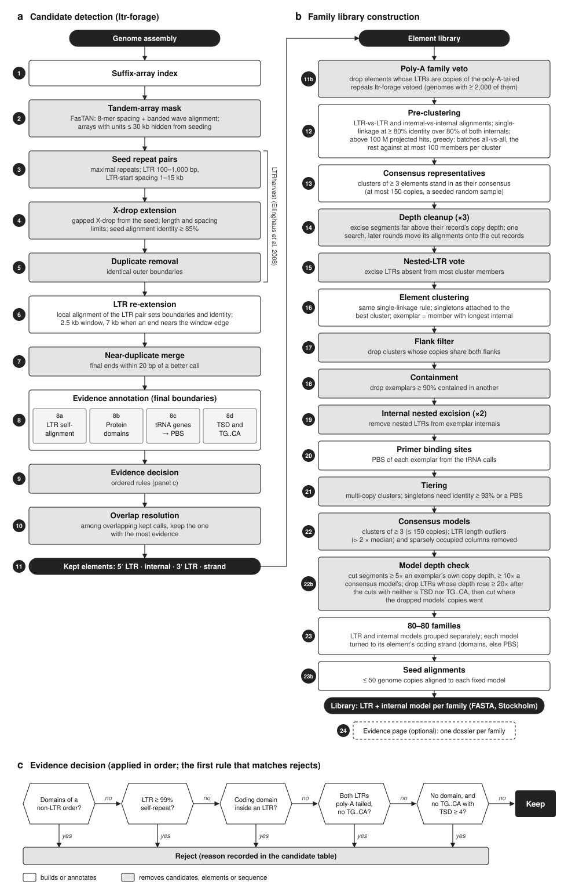

# ltr-forage

A tool for the identification of LTR retrotransposon copies, and clustering
those copies into a succinct library of families.

## Overview
### De novo LTR identification
**ltr-forage** identifies putative long-terminal-repeats (LTRs) in genome 
assemblies using the search algorithm of [LTRharvest](https://github.com/genometools/genometools) 
(Ellinghaus, Kurtz and Willhoeft), reimplemented on the incredibly fast
[sufr](https://github.com/TravisWheelerLab/sufr) suffix-array index.  It
also bundles functionality LTRHarvest leaves to other tools: a mask for
tandem arrays (using Gene Meyers excellent FasTAN algorithm), LTR boundaries 
refinement, and evidence from each element itself (protein domains, target site duplication,
TG..CA ends, a primer binding site matched to the genome's own tRNA genes etc.).  The
tool writes out the per-copy metadata and FASTA sequences.  Using the `--ltrharvest` option,
ltr-forage will run only the LTRHarvest equivalent search and writes LTRHarvest output 
format, as a drop-in replacement in existing pipelines. On hg38 with LTRharvest's default parameters 
both report 41,665 candidates: 41,264 agree in every coordinate, 254 share outer
boundaries but differ inside, 133 differ in position, and 14 on each side
appear in only one output (see
[Comparing with GenomeTools LTRharvest on hg38](#comparing-with-genometools-ltrharvest-on-hg38)).

`ltr-forage` holds neither the suffix array nor the LCP array in memory.  It
streams both from the file during the seed search, reading each once, in
order, so peak memory scales with the genome rather than with the index:
searching the 3.2 Gb hg38 genome needs about 4.5 GB.  Seed search and the per-candidate
steps run in parallel.

### Library Building
An additional pipeline (`ltr_library.py`) builds on the kept elements produced by ltr-forage to 
create a succinct LTR family library from a genome assembly: one LTR and one internal model per
family, cleaned of nested insertions and segmental duplications (see
[Building a family library](#building-a-family-library)).



The numbered boxes are the steps `ltr-forage` (1-11) and the library driver
(12-24) name in their logs.


## Installation

### Installing a release

Each [release](https://github.com/Dfam-consortium/ltr-forage/releases) has an
archive for Linux (x86_64) and macOS (Apple Silicon):

```bash
tar -xzf ltr-forage-0.1.0-x86_64-unknown-linux-gnu.tar.gz
export PATH=$PWD/ltr-forage-0.1.0/bin:$PATH          # tcsh: set path = ($cwd/ltr-forage-0.1.0/bin $path)
ltr-forage --version
```

The archive holds `bin/ltr-forage`, `bin/ltr_library.py` (a link to
`pipeline/ltr_library.py`), the driver's step scripts in `pipeline/`, the
protein profiles and scoring matrices in `data/`, and the example in
`examples/`.  The tree can be moved: `ltr-forage` finds
`data/TEdomains.hmm` beside its `bin/`, and the driver finds its scripts and
`data/` beside itself.  The other programs below are not included.

### Prerequisites

- The `sufr` tool for building `.sufr` index files
  ([TravisWheelerLab/sufr](https://github.com/TravisWheelerLab/sufr)),
  version 0.7.12.  sufr 0.8.0 writes a new index format that this release
  cannot read.
- For the protein-domain search (step 8b): `nail` ≥ 0.7.1
  ([TravisWheelerLab/nail](https://github.com/TravisWheelerLab/nail)) and
  MMseqs2 (`mmseqs`), which nail seeds with; not needed with `--no-domains`
  or `--ltrharvest`.  The protein profiles ship in `data/TEdomains.hmm`.
- To build from source: a recent stable Rust toolchain
  ([rustup](https://rustup.rs) recommended).

For the family-library driver (`pipeline/ltr_library.py`) also:

- Python ≥ 3.8 with numpy
- The Rust port of RMBlast, `rmblastn` ≥ 3.0.9
  ([Dfam-consortium/rmblast](https://github.com/Dfam-consortium/rmblast));
  NCBI's C++ `rmblastn` does not take the options the driver uses; 3.0.11 or later
  is recommended (3.0.10's streaming `--mt-mode 1` can deadlock, and the driver
  falls back to `--mt-mode 0` with it)
- `te-composer` from dfam-curator ≥ 0.6.6 (consensus models)

### Build from source

```bash
git clone https://github.com/Dfam-consortium/ltr-forage.git
cd ltr-forage
make                               # cargo build --release; the binary is target/release/ltr-forage
make install PREFIX=$HOME/opt      # optional: the release layout in $HOME/opt/ltr-forage-<version>/
```

The build fetches libsufr and rmblast-lib from GitHub (pinned in
`Cargo.toml`).  A binary built in the checkout finds `data/TEdomains.hmm`
two levels up, and `--version` names the commit it was built from, with
`-dirty` when the source had uncommitted changes.

### Finding the programs

Neither program has built-in install locations.  `ltr-forage` takes nail and
MMseqs2 from `--nail` and `--mmseqs`, else the `NAIL` and `MMSEQS`
environment variables, else `PATH`.  `ltr_library.py` finds each program the
same way:

| Program | Option | Environment variable |
|---|---|---|
| ltr-forage | `--ltr-forage` | `LTRFORAGE` |
| sufr (only when the driver builds the index) | `--sufr-bin` | `SUFR` |
| rmblastn (the Rust port) | `--rmblastn` | `RMBLASTN` |
| te-composer | `--te-composer` | `TE_COMPOSER` |
| nail | `--nail` | `NAIL` |
| MMseqs2 | `--mmseqs` | `MMSEQS` |

It skips a program older than it needs and says which one it skipped when
none qualifies.  Each library run writes the path and version of every
program it used to `out/run.log`.  For example, with the programs in
`/opt/tools`:

```bash
export NAIL=/opt/tools/nail/nail MMSEQS=/opt/tools/mmseqs/bin/mmseqs        # bash
setenv NAIL /opt/tools/nail/nail; setenv MMSEQS /opt/tools/mmseqs/bin/mmseqs  # tcsh
```


## Quick start

Install a release or build from source, with sufr, nail, MMseqs2,
rmblastn and te-composer findable.  To try it on a small
genome first, run the
[example on Arabidopsis chromosome 4](#example-arabidopsis-chromosome-4).

### 1. Index the genome (once)

```bash
sufr create --dna -o genome.sufr genome.fa
```

Do not pass `--ignore-softmask` on a soft-masked assembly (see
[Create a sufr index](#create-a-sufr-index)).  sufr writes its partition files to `$TMPDIR` (`/tmp` when
unset) and needs up to the size of the finished index there, about 9 bytes
per genome base (see [Create a sufr index](#create-a-sufr-index)).

### 2. Detect LTR retrotransposon copies

```bash
ltr-forage genome.sufr --library elements.fa --fastan-out tandem.bed -t 24 \
    --log ltr-forage.log > cand.tsv
```

The defaults are the settings the library driver uses: tandem arrays
masked, LTR pairs re-aligned in a 7 kb window, calls whose final ends agree
within 20 bp merged, protein domains searched with `data/TEdomains.hmm`
(122 Pfam profiles), overlapping calls resolved by evidence,
and the per-candidate table on stdout.  The domain search writes about 2 GB
of scratch files for a primate genome to `$TMPDIR` or `/tmp`;
`--temp-dir DIR` puts them elsewhere.  nail and MMseqs2 come from `--nail`
and `--mmseqs`, else the `NAIL` and `MMSEQS` environment variables, else
`PATH`.  `ltr-forage` checks its programs, the profile file and the output
directories before it loads the index, and reports every problem at once.
`-h` lists the options most runs need; `--help-all` adds the development and
tuning ones.

| File | Contents |
|---|---|
| `cand.tsv` | every candidate, kept or not, with the evidence behind the call: boundaries, LTR identity, TSD, TG..CA, PBS and its tRNA, protein domains, LTR self-repeat; `keep` is 1 for a kept element and `evidence` says which rule kept or rejected it (see [Per-candidate table](#per-candidate-table)) |
| `elements.fa` | each kept element's 5′ LTR, internal region and 3′ LTR, on the genome's plus strand; `strand=` in the header is the element's coding strand (`+`, `-`, `?`) |
| `tandem.bed` | the masked tandem arrays (name, start, end, period, 1000 × identity) |
| `ltr-forage.log` | `--log`: the screen's lines and every step's own lines, numbered as in the figure and in [How ltr-forage finds elements](#how-ltr-forage-finds-elements) |

The screen (stderr) shows each stage as it starts and a summary at the end;
on Arabidopsis chromosome 4 (18.6 Mb, 8 threads):

```
[14:23:01] ltr-forage ath_chr4.sufr --library elements.fa --fastan-out tandem.bed -t 8 --log ltr-forage.log
[14:23:01] Index and Tandem-Array Mask (stages 1-2)
[14:23:01]   1 sequence(s), 18.6 Mb
[14:23:09]   2,729 tandem array(s) masked (0.8 Mb)
[14:23:09] Candidate Detection (stages 3-7)
[14:23:27]   823 candidate element(s) from 3,470 seed pair(s)
[14:23:27] Evidence (stage 8)
[14:23:48]   230 with a protein domain hit (154 LTR order), 34 with a PBS, 82 with a TSD, 30 with TG..CA ends
[14:23:48] Decision and Output (stages 9-11)
[14:23:48] Results
[14:23:48]   116 LTR retrotransposon element(s) kept of 823 candidate(s)
[14:23:48]   rejected: 76 non-LTR protein hits, 54 LTR self-repeat, 9 domain inside an LTR, 0 poly-A-tailed LTRs, 35 overlapping a call with more evidence, 533 too little evidence
[14:23:48]   output: candidate table on stdout, elements.fa, tandem.bed
[14:23:48] done: 0.8 min
```

The kept copies as BED:

```bash
awk -F'\t' 'NR==1 {for (i = 1; i <= NF; i++) c[$i] = i; next}
            $c["keep"] == 1 {print $1"\t"$2-1"\t"$3"\t"$c["evidence"]"\t"$c["identity"]}' cand.tsv > copies.bed
```

`--format gt` writes the kept elements in LTRharvest's format instead of the
table.  The evidence for each copy is in `cand.tsv`; there is no per-copy HTML report
yet (the evidence page below is per family and needs the library run).

### 3. Build a family library, with the evidence page

```bash
pipeline/ltr_library.py genome.fa -o out -t 24 --evidence-page
```

This runs step 2 itself (with the same settings) and then clusters the
kept elements into families.  The screen shows each stage as it starts and
a summary at the end; on Arabidopsis chromosome 4 (18.6 Mb, 8 threads):

```
[13:47:58] ltr_library.py ath_chr4.fa -o out -t 8 --evidence-page
[13:47:58] Sequence & Suffix Array Preparation (stages 0-1)
[13:47:58]   genome 18.6 Mb non-N; depth sample 100.0% of the genome; floors 5 / 50
[13:48:01] LTR Detection: ltr-forage (stages 1-11)
[13:48:35]   117 LTR retrotransposon copies kept of 823 candidates (cand.tsv)
[13:48:35] Library Building
[13:48:35]   stages 12-13: clustering and consensus building
[13:48:41]   stages 14-22: artifact cleanup
[13:51:37]   stage    23: families and seed alignments
[13:51:41]   stage    24: evidence page
[13:51:43] Results
[13:51:43]   families: 48 (48 LTR and 48 internal models)
[13:51:43]   evidence: Well supported 23, Weak evidence 21, Possible artifact 4
[13:51:43]   output in out: library.fa, library.stk, families.tsv, cand.tsv, evidence.html, run.log
[13:51:43] done: 3.7 min
```

| File in `out/` | Contents |
|---|---|
| `library.fa` | the family library: one LTR and one internal model per family |
| `library.stk` | a seed alignment per model |
| `families.tsv` | each model's family, origin element, class, orientation (what set its strand; `flipped` when it was reverse-complemented to it) and estimated share of the genome |
| `cand.tsv` | ltr-forage's per-candidate table: the detected copies and the evidence behind each call (see [Per-candidate table](#per-candidate-table)) |
| `evidence.html` | with `--evidence-page`: one dossier per family |
| `run.log` | every step (numbered on from ltr-forage's, 12-24) with its time and results, ltr-forage's own step lines, and the programs, versions and paths used |

`-v` prints all of `run.log` on the screen as the run goes.  The steps work
in `out/work/`, which a successful run removes; `--keep-work` keeps it (each
step's files, their command logs in `out/work/logs/`, and the sufr index the
run built), and `--from STEP` needs it.  A run that stops keeps
`out/work/`, and the same command resumes it.

`out/evidence.html` has one dossier per family, drawn from the element it
was founded on: a track with LTRs, gaps, TSD, PBS, polypurine tract and
protein domains, the 5′ against 3′ LTR alignment, and the family's
full-length copies. Each family gets a verdict with its reasons:

| Verdict | Means |
|---|---|
| Well supported (Likely novel family with a reference) | at least three lines of evidence (two or more domains, TSD, TG..CA, PBS, copies on several sequences, many genome copies), or two domains and two more |
| Known family | with `--evidence-reference`: an LTR or internal model at least 80% identical over 80% of a curated family |
| Weak evidence | little beyond the LTR pair: the families to check by hand |
| Possible artifact | domains on both strands (a nested pair), copies sharing both flanks (a segmental duplication), or all copies on one sequence and few elsewhere |

`--evidence-reference curated_LTR.fa` measures each family against a curated
library. To add the page to a finished run made with `--keep-work`, run the
same command with `--evidence-page --from evidence`. With a curated annotation of the genome,
`pipeline/evidence_page.py` can also select the families that mask most
outside it (see [Evidence page](#evidence-page)).

### LTRharvest's search only

```bash
ltr-forage genome.sufr --ltrharvest -t 24 > ltrharvest.out
```

This is LTRharvest's default search and output format (see
[LTRharvest mode](#ltrharvest-mode---ltrharvest)).

---

## Example: Arabidopsis chromosome 4

`examples/ath_chr4.fa.gz` is chromosome 4 of *Arabidopsis thaliana*
(TAIR10.1, NCBI RefSeq NC_003075.7): 18.6 Mb, with a pericentromere full of
Gypsy and Copia elements.  The whole example takes about five minutes on 8
threads.  The commands below run in an empty directory, with `ltr-forage`,
`ltr_library.py` and the other programs findable (from a source checkout,
use `target/release/ltr-forage` and `pipeline/ltr_library.py`, or set
`LTRFORAGE`):

```bash
gzip -dc /path/to/ltr-forage/examples/ath_chr4.fa.gz > ath_chr4.fa
sufr create --dna -o ath_chr4.sufr ath_chr4.fa                  # 2 s, 167 MB
```

**Copies only.**  ltr-forage alone writes the candidate table, the kept
elements and the masked tandem arrays (under a minute):

```bash
ltr-forage ath_chr4.sufr -t 8 --library elements.fa --fastan-out tandem.bed \
    --log ltr-forage.log > cand.tsv
```

```
[15:03:21] ltr-forage ath_chr4.sufr -t 8 --library elements.fa --fastan-out tandem.bed --log ltr-forage.log
[15:03:21] Index and Tandem-Array Mask (stages 1-2)
[15:03:21]   1 sequence(s), 18.6 Mb
[15:03:28]   2,729 tandem array(s) masked (0.8 Mb)
[15:03:28] Candidate Detection (stages 3-7)
[15:03:46]   823 candidate element(s) from 3,470 seed pair(s)
[15:03:46] Evidence (stage 8)
[15:04:08]   230 with a protein domain hit (154 LTR order), 34 with a PBS, 82 with a TSD, 30 with TG..CA ends
[15:04:08] Decision and Output (stages 9-11)
[15:04:08] Results
[15:04:08]   116 LTR retrotransposon element(s) kept of 823 candidate(s)
[15:04:08]   rejected: 76 non-LTR protein hits, 54 LTR self-repeat, 9 domain inside an LTR, 0 poly-A-tailed LTRs, 35 overlapping a call with more evidence, 533 too little evidence
[15:04:08]   output: candidate table on stdout, elements.fa, tandem.bed
[15:04:08] done: 0.8 min
```

`cand.tsv` has one row per candidate (all 823), with `keep` and the
`evidence` that decided it; `elements.fa` has each kept element as its 5′
LTR, internal region and 3′ LTR, with the class, evidence and coding strand
in the header.  To tally why candidates were kept or rejected:

```bash
awk -F'\t' 'NR==1 {for (i = 1; i <= NF; i++) c[$i] = i; next}
            {print $c["keep"], $c["evidence"]}' cand.tsv | sort | uniq -c | sort -nr | head
```

**A family library.**  The driver runs ltr-forage itself (it finds
`ath_chr4.sufr` beside the genome) and builds the families:

```bash
ltr_library.py ath_chr4.fa -o out -t 8 --evidence-page
```

```
[15:04:08] ltr_library.py ath_chr4.fa -o out -t 8 --evidence-page
[15:04:08] Sequence & Suffix Array Preparation (stages 0-1)
[15:04:08]   genome 18.6 Mb non-N; depth sample 100.0% of the genome; floors 5 / 50
[15:04:08] LTR Detection: ltr-forage (stages 1-11)
[15:04:54]   116 LTR retrotransposon copies kept of 823 candidates (cand.tsv)
[15:04:54] Library Building
[15:04:54]   stages 12-13: clustering and consensus building
[15:05:00]   stages 14-22: artifact cleanup
[15:07:53]   stage    23: families and seed alignments
[15:07:57]   stage    24: evidence page
[15:07:58] Results
[15:07:58]   families: 47 (47 LTR and 47 internal models)
[15:07:58]   evidence: Well supported 22, Weak evidence 21, Possible artifact 4
[15:07:58]   output in out: library.fa, library.stk, families.tsv, cand.tsv, evidence.html, run.log
[15:07:58] done: 3.8 min
```

`out/library.fa` is the library, one LTR and one internal model per family,
each in its element's coding strand where the domains or PBS give it;
`out/library.stk` holds a seed alignment per model; `out/families.tsv`
describes each model; `out/evidence.html` has a dossier per family, with a
verdict (open it in a browser); `out/run.log` has every step's numbers and
the programs and versions used.  The intermediate files are removed after a
successful run; `--keep-work` keeps them in `out/work/`, and `-v` prints
every step as it runs.  `ltr_library.py -h` lists the options most runs
need, `--help-all` all of them.

---

## Background and Credits

The search algorithm implemented here is a Claude (AI) generated port of the
original LTRharvest algorithm described in:

> Ellinghaus D, Kurtz S, Willhoeft U.
> **LTRharvest, an efficient and flexible software for de novo detection of LTR
> retrotransposons.**
> *BMC Bioinformatics.* 2008;**9**:18.
> DOI:[10.1186/1471-2105-9-18](https://doi.org/10.1186/1471-2105-9-18)

LTRharvest is distributed as part of
[GenomeTools](https://github.com/genometools/genometools):

> Gremme G, Steinbiss S, Kurtz S.
> **GenomeTools: A Comprehensive Software Library for Efficient Processing of
> Structured Genome Annotations.**
> *IEEE/ACM Trans Comput Biol Bioinform.* 2013;**10**(3):645–56.
> DOI:[10.1109/TCBB.2013.68](https://doi.org/10.1109/TCBB.2013.68)

The suffix-array index used by ltr-forage is provided by the
[`sufr`](https://github.com/TravisWheelerLab/sufr) project, developed by Ken
Youens-Clark, Jack Roddy, and Travis Wheeler at the University of Arizona.

The tandem-array mask (`src/fastan.rs`) is a port of Gene Myers' FasTAN
([github.com/thegenemyers/FASTAN](https://github.com/thegenemyers/FASTAN)),
including the wave aligner it takes from daligner (Myers 2014).

The default protein profiles, `data/TEdomains.hmm`, are 122 Pfam profiles
of transposable-element proteins: 116 from Pfam 39.0 and six from
LTR_retriever's `database/TEfam.hmm` (Ou and Jiang 2018).  The choice of
profiles starts from LTR_retriever's list.  `data/TEfam.hmm` is
LTR_retriever's file itself (102 Pfam profiles), distributed under GPL v3.


## Usage

```
ltr-forage [OPTIONS] <SUFR>
ltr-forage --ltrharvest [LTRharvest options] <SUFR>
ltr-forage --trna-scan <FASTA> [-t N] [--trna-intron-max BP]

Arguments:
  <SUFR>  Path to a .sufr index file (created with `sufr create --dna`)

Seed and extension options:
  -m, --min-seed <BP>       Minimum seed length (min exact match) [default: 30]
  -l, --ltr-min <BP>        Minimum LTR length [default: 100]
  -L, --ltr-max <BP>        Maximum LTR length at the X-drop stage [default: 1000]
  -d, --dist-min <BP>       Minimum 5'-to-5' distance between LTRs [default: 1000]
  -D, --dist-max <BP>       Maximum 5'-to-5' distance between LTRs [default: 15000]
  -s, --similar <PCT>       Minimum percent similarity between LTR copies [default: 85]
  -x, --xdrop <SCORE>       X-drop threshold for extension alignment [default: 5]
      --mat <MAT>           Match score (positive) [default: 2]
      --mis <MIS>           Mismatch score (negative) [default: -2]
      --ins <INS>           Insertion score (negative) [default: -3]
      --del <DEL>           Deletion score (negative) [default: -3]

Tandem-array mask (step 2):
      --no-fastan           Search tandem arrays for seeds too
      --fastan-out <FILE>   Write the masked arrays as BED (name, start, end, period, 1000 x identity)
      --fastan-only         Only find the arrays (writes --fastan-out) and exit
      --mask-bed <FILE>     Also mask these intervals (BED: name, 0-based start, end);
                            a line that does not parse is an error

Re-extension and near duplicates (steps 6, 7):
      --reextend-ltr-max <BP>   Longest LTR the alignment window reaches beyond each X-drop
                            end [default: 7000]
      --reextend-vicinity <BP>  Extra window beyond that on the outer side of each LTR [default: 100]
      --reextend-first <BP>     Re-extend with this window first, the full one only near its
                            edge; 0 disables [default: 2500]
      --reextend-first-margin <BP>  A first-pass end within BP of the window edge counts as
                            reaching it [default: 500]
      --trim-window <N>     Terminal alignment columns that must be clean for an end to stand [default: 6]
      --trim-matches <N>    Matches required inside that terminal window [default: 6]
      --dedup-tol <BP>      Merge candidates whose final outer ends both lie within BP of a
                            better one's; 0 disables [default: 20]
      --internal-stats      Count 20-mers of each internal region against the index and
                            report coverage and the longest single-copy stretch

Protein domains (step 8b):
      --domain-hmm <FILE>   HMMER3 file of protein profiles [default: data/TEdomains.hmm]
      --no-domains          Skip the domain search
      --domain-evalue <E>   E-value threshold for a domain hit [default: 0.05]
      --domain-z <N>        Database size for the domain E-values (nail's -Z); 0: six frames per candidate of this run [default: 120000]
      --domain-flank <BP>   Bases added on each side of the element before translation [default: 50]
      --nail <PATH>         nail binary (a path, or a name on PATH) [env: NAIL] [default: nail]
      --mmseqs <PATH>       MMseqs2 binary nail seeds with [env: MMSEQS] [default: mmseqs]
      --temp-dir <DIR>      Directory for scratch files [default: $TMPDIR, else /tmp]
      --domain-search-vetoed  Search candidates the self-alignment check rejected too
      --keep-coding-ltrs    Keep candidates with a polyprotein domain hit inside an LTR

Primer binding site (step 8c):
      --no-pbs-trna         Skip the genome tRNA scan behind the PBS
      --pbs-domain-strand   Search for the PBS only on the strand the protein domains give (default: both)
      --trna-out <FILE>     Write the genome's tRNA library (FASTA) and every call (FILE.tsv)
      --trna-intron-max <BP>  Longest tRNA intron searched for, 0 to 3000 [default: 3000]
      --trna-scan <FASTA>   Only scan FASTA for tRNA genes, print the calls and exit

Decision and overlaps (steps 9, 10):
      --keep <LEVEL>        Evidence a candidate needs: domain | standard | loose | none [default: standard]
      --tandem-max <FRAC>   Reject a candidate when either LTR aligns to itself off the diagonal
                            over at least this fraction of its length [default: 0.99]
      --internal-gap-max <FRAC>  Also reject candidates whose internal region has a single-copy
                            stretch longer than this fraction of it (needs --internal-stats)
      --overlaps <STRATEGY> evidence | best | no | all [default: evidence; best with --ltrharvest]

Output (step 11):
      --format <FORMAT>     tsv | gt [default: tsv; gt with --ltrharvest]; gt lists the kept
                            elements (every prediction with --ltrharvest)
      --library <FILE>      Write the kept elements as a FASTA library (left LTR, internal
                            region, right LTR per element)
  -t, --threads <N>         Threads (0 = all CPUs; -j also works) [default: 0]
  -v, --verbose             Print every step's own lines (the screen otherwise shows stages and results)
      --log <FILE>          Also write the whole log to FILE
  -h, --help                Print help (the options most runs need)
      --help-all            Print help with the development and tuning options too

LTRharvest mode:
      --ltrharvest          LTRharvest's search only: TSD boundary move, overlaps best, gt output
      --mintsd <BP>         Minimum TSD length; 0 or 1 disables the TSD search [default: 4]
      --maxtsd <BP>         Maximum TSD length [default: 20]
      --vicinity <BP>       Search window around the LTR boundaries for TSD and motif [default: 60]
      --motif               Require the TG...CA motif at the LTR ends
      --motifmis <N>        Allowed mismatches in the motif [default: 0]
      --tiered-tsd          Rank TSD candidates LTR_retriever's way instead of by smallest shift
```

### Example — LTRharvest's defaults

```bash
ltr-forage hg38.sufr --ltrharvest -t 32 > hg38_ltrs.out
```

which is, with every LTRharvest default written out,

```bash
ltr-forage hg38.sufr --ltrharvest \
    --min-seed 30 \
    --ltr-min 100 --ltr-max 1000 \
    --dist-min 1000 --dist-max 15000 \
    --similar 85 \
    --xdrop 5 \
    --mat 2 --mis -2 --ins -3 --del -3 \
    --mintsd 4 --maxtsd 20 \
    --vicinity 60 \
    --overlaps best \
    -t 32 > hg38_ltrs.out
```

---

## Output Format

The default output is the per-candidate table below.  `--format gt` (the
default with `--ltrharvest`) is compatible with GenomeTools LTRharvest.
LTRharvest's table has no keep column, so outside `--ltrharvest` it lists
the kept elements only, with their final (re-extended) coordinates.
The file begins with a comment block describing the parameters and column
layout, followed by one space-separated data line per prediction.

```
# args=-index hg38.sufr -seed 30 -minlenltr 100 -maxlenltr 1000 ...
# predictions are reported in the following way
# s(ret) e(ret) l(ret) s(lLTR) e(lLTR) l(lLTR) s(rLTR) e(rLTR) l(rLTR) sim(LTRs) seq-nr
# where:
# s = starting position
# e = ending position
# l = length
# ret = LTR-retrotransposon
# lLTR = left LTR
# rLTR = right LTR
# sim = similarity
# seq-nr = sequence number
135253  138333  3081  135253  135376  124  138219  138333  115  87.10  0
```

All positions are **1-based and inclusive**.  The `seq-nr` column is a
**0-based** index into the sequences in the `.sufr` index.

| Column | Field | Description |
|---|---|---|
| 1 | s(ret) | Element start (= left LTR start) |
| 2 | e(ret) | Element end (= right LTR end) |
| 3 | l(ret) | Element length |
| 4 | s(lLTR) | Left LTR start |
| 5 | e(lLTR) | Left LTR end |
| 6 | l(lLTR) | Left LTR length |
| 7 | s(rLTR) | Right LTR start |
| 8 | e(rLTR) | Right LTR end |
| 9 | l(rLTR) | Right LTR length |
| 10 | sim(LTRs) | Percent similarity between LTR copies |
| 11 | seq-nr | Sequence number (0-based) |

---

### Per-candidate table

The table (`--format tsv`, the default) has a header line and one tab-separated row per candidate,
with every value the later stages decide on, so a decision can be inspected
rather than inferred. Coordinates are 1-based and inclusive, relative to the
sequence named in the first column.

| Column | Description |
|---|---|
| `seq` | Sequence name from the index |
| `elem_start`, `elem_end`, `elem_len` | Element span |
| `lltr_start`, `lltr_end`, `lltr_len`, `rltr_start`, `rltr_end`, `rltr_len` | LTR spans after re-extension (the X-drop spans when no alignment qualified) |
| `identity` | Identity of the trimmed alignment in percent, gaps counted as differences; the X-drop similarity when not re-extended |
| `xdrop_lltr_start` … `xdrop_rltr_end`, `xdrop_similarity` | The boundaries and similarity the X-drop stage produced |
| `reextended` | 1 when the row's boundaries come from the alignment |
| `aln_score`, `aln_columns` | Raw score and aligned columns of the trimmed alignment |
| `trim_l5`, `trim_r5`, `trim_l3`, `trim_r3` | Bases removed by the end trim at the 5′ end of the left and right LTR and at their 3′ ends |
| `window_edge` | 1 when the alignment reached within 5 bp of a window edge that was not a sequence end: the LTR may be longer than the window, or the pair sits in a larger duplication |
| `tsd_len`, `tsd_seq`, `tsd_shift_l`, `tsd_shift_r` | Longest exact direct repeat (4 to 20 bp) flanking the element, allowing 0 or 1 bp of play at each end; failing that, a 6 or 5 bp repeat with one mismatch directly against both LTR ends (see `tsd_mm`). `tsd_seq` is the left copy; `.` and 0 when none |
| `motif`, `motif_class` | First two bases of the left LTR and last two of the right LTR, and LTR_retriever's reading of them: `TGCA` for the canonical termini, `known` for the other pairs its rules accept (TGCT, TACA, TACT, TGGA, TGGT, TATA, TGTA, TGCC), `other` |
| `ppt_purines15`, `ppt_offset` | Purine count in the most purine-rich 15 bp window within 30 bp before the right LTR, and that window's start relative to the right LTR |
| `pbs_offset` | Start of the primer binding site relative to the first base after the 5′ LTR (−5 to +15), from the 12-nt tRNA match described under step 8c; `.` when none or with `--no-pbs-trna` (it was −1 before 2026-11-15, which is also a valid offset) |
| `n_count` | Ns inside the element |
| `xdrop_tsd_len` | Always 0: the TSD search at the X-drop ends runs only in LTRharvest mode, which writes no table (the column is kept so the others do not move) |
| `int_tiles`, `int_multi_frac`, `int_gap_frac`, `int_gap_bp` | With `--internal-stats`: number of 20-mer tiles taken every 10 bp across the internal region (tiles containing N skipped), the fraction seen at least three times in the genome on either strand, and the longest run of single-copy tiles as a fraction of the tiles and in bases; `.` otherwise |
| `dom_order`, `dom_superfamily`, `dom_strand` | `LTR`, `notLTR`, `mixture`, `NA` or `none`; `Gypsy`, `Copia` or `unknown`; `+`, `-` or `?`, as described under step 8b; `.` with `--no-domains` or for a candidate the self-alignment check rejected |
| `dom_best_e`, `dom_hits` | Best E-value, and every hit as `accession:E-value:frame` (frames `aa1`..`aa3` forward, `rev_aa1`..`rev_aa3` on the reverse complement), comma separated; `.` when none |
| `ltr_dom_hits` | Hits to the LTR-order (polyprotein) profiles when each LTR is searched on its own, summed over the two LTRs; 0 when `--keep-coding-ltrs` skips the search |
| `lltr_self_cov`, `rltr_self_cov` | Fraction of each LTR covered by plus-strand alignments of the LTR against itself off the main diagonal; 1.00 for a satellite monomer or an Alu dimer, 0 for unique sequence |
| `keep`, `evidence` | 1 when the candidate is kept, and what decided it: `domain`, `tsdN`, `tgca` (comma separated), `veto:notLTR`, `veto:mixture`, `veto:tandemF`, `veto:ltrdomainN`, `veto:polyA`, `gapF` when `--internal-gap-max` rejected it, or `none`; `,overlap` is appended when step 10 dropped a kept candidate for an overlapping one with more evidence.  In the library driver's `cand.tsv`, step 11b adds `veto:polyAfamily` to the elements it vetoes and writes `rescued` in place of `overlap` on those it keeps again |
| `pbs_trna`, `pbs_mm12` | The tRNA type(s) whose 3′-terminal 12 nt match the PBS, e.g. `Met(cat)` (several joined by `/` when they share the 12 nt), and the mismatches (0 or 1); `.` when none |
| `pbs_edist18` | Best edit distance (0 to 2) of a full 18-nt tRNA probe over the same window; `.` when none |
| `pbs_strand` | `+` when the PBS was found after the left LTR, `-` when before the right LTR on the reverse strand; `.` when none |
| `tsd_mm` | 1 when the TSD is the one-mismatch fallback, else 0. It is enriched about 20-fold over shifted flanks only for TG..CA elements (lotus), so it counts toward `--keep standard`/`loose` only alongside TG..CA; the evidence tag reads `tsd5mm1` |
| `strand` | The element's coding strand: `dom_strand` when it is `+` or `-`, else `pbs_strand`; `?` when neither is known or the two disagree.  Coordinates and `elements.fa` stay on the genome's plus strand; `elements.fa` headers carry it as `strand=` |

The internal-region columns describe whether the sequence between the LTRs
looks repeat-derived end to end. An LTR element's internal region rarely
contains a long single-copy stretch; the sequence between two SINE copies a
few kb apart usually does. On hg38 a longest single-copy stretch of at most
10% of the region holds for 96% of annotated elements and 32% of the other
candidates; in Arabidopsis, whose LTR families are low copy, the same cut
keeps only half the real elements, so the statistic is reported here and any
filter on it is a separate choice. The count loads the suffix array (4 bytes
per base for genomes under 4 Gb) and the tile table: on hg38, 25.5 million
tiles, 140 s and 45 GB at peak; on rice, 30 s.


### Library Building (ltr_pipeline.py) Output

| File | Contents |
|------|----------|
| `library.fa` | The family library: `fam<N>_v<k>_LTR` and `fam<N>_v<k>_INT` records, classified `#LTR/Gypsy`, `#LTR/Copia` or `#LTR` |
| `library.stk` | A Stockholm seed alignment per model, with the model as `#=GC RF` (step 23b) |
| `families.tsv` | Each model's family, origin element, kind, length, status and class; `orientation` (what set the model's strand: `domains+PBS`, `domains`, `PBS`, or `conflict` / `unknown` when it was left as found) and `flipped` (`yes` when it was reverse-complemented to the coding strand); `est_genome_pct` |
| `cand.tsv` | ltr-forage's per-candidate table, with every value behind its decision (see [Per-candidate table](#per-candidate-table)) |
| `run.log` | Each run's command, programs, versions and paths; every step's time and results; ltr-forage's step lines |
| `evidence.html` | With `--evidence-page`: one dossier per family (see below) |

With `--keep-work`, `out/work/` also holds every step's files, among them
`sd_clusters.tsv` (the clusters tested for segmental duplication, and the
call) and the sufr index the run built.

### Evidence page

`--evidence-page` writes `evidence.html`, a self-contained page with one
dossier per family, drawn from the family's founding element: LTRs, assembly
gaps, TSD, primer binding site, polypurine tract and protein domains on a
genome-browser style track, the 5′ and 3′ LTR alignment, and the family's
full-length copies and the sequences they lie on.  The element is drawn in
the orientation of the family's models: a minus-strand element is shown
reverse-complemented, with its location and the orientation evidence in the
dossier.  Each family gets a
triage verdict (likely novel or well supported, known family, weak
evidence, possible artifact) with the evidence behind it.
`--evidence-reference LIB` adds the nearest family in a curated library.

Run by hand on the `work/` directory of a `--keep-work` run, `pipeline/evidence_page.py` also takes a RepeatMasker run of
the genome with the library (`--mask`), the curated annotation
(`--standard`) and another tool's mask (`--other NAME=OUT`).  It then shows
each family's masking inside and outside the curated LTR annotation and how
much of the rest the other tool finds too, and `--families top-fp:N`
selects the families with the most masking outside it:

```bash
pipeline/evidence_page.py out/work genome.fa -o fp.html --families top-fp:30 \
    --reference curated.fa --mask genome.fa.out --standard curated.fa.out \
    --other HiRepEat=hirepeat.fa.out
```

### Accuracy

Each library was scored by masking the genome with RepeatMasker and
comparing with a curated annotation of the same genome: sensitivity and
precision over the bases the curated LTR annotation covers.  Recovered
families are the curated LTR and internal models that one library record
covers over at least 80% of its length.  Every row was scored with the same
recipe (`eval/benchmarks/recipe/compare_libs.sh`) against the same
standards.  The first six genomes were used for tuning; the others were not.

| Genome | Library | Sensitivity | Precision | Recovered LTR / INT | Time | Peak memory |
|--------|---------|-------------|-----------|---------------------|------|-------------|
| Arabidopsis (TAIR10.1) | ltr_library.py | 91.05% | 95.46% | 121/150 / 123/150 | 28 min | 1.3 GB |
| | LTRPipeline | 72.85% | 92.08% | 62/150 / 50/150 | 10 min | 13.9 GB |
| | HiRepEat | 64.24% | 99.49% | 16/150 / 14/150 | 3 min | 0.5 GB |
| Rice (MSU7) | ltr_library.py | 93.56% | 98.42% | 309/488 / 306/409 | 76 min | 12.0 GB |
| | LTRPipeline | 92.07% | 87.58% | 204/488 / 206/409 | 134 min | 13.7 GB |
| | HiRepEat | 83.10% | 99.61% | 87/488 / 75/409 | 19 min | 1.0 GB |
| Zebra finch (bTaeGut7) | ltr_library.py | 76.08% | 86.28% | 130/258 / 32/34 | 50 min | 2.0 GB |
| | LTRPipeline | 77.56% | 68.73% | 98/258 / 27/34 | 298 min | 14.8 GB |
| | HiRepEat | 70.58% | 90.86% | 92/258 / 29/34 | 20 min | 1.4 GB |
| Lotus (ChineseLotus 1.1) | ltr_library.py | 92.63% | 94.20% | 288/433 / 296/367 | 276 min | 14.3 GB |
| | LTRPipeline | 87.96% | 87.32% | 202/433 / 173/367 | 68 min | 17.8 GB |
| | HiRepEat | 72.55% | 99.34% | 63/433 / 89/367 | 6 min | 0.8 GB |
| Mouse (mm10) | ltr_library.py | 44.21% | 96.38% | 117/525 / 43/116 | 258 min | 38.5 GB |
| | LTRPipeline | 48.64% | 25.43% | 72/525 / 35/116 | 552 min | 21.7 GB |
| | HiRepEat | 24.04% | 65.46% | 61/525 / 30/116 | 31 min | 3.1 GB |
| Gorilla (mGorGor1 v2.1) | ltr_library.py | 40.25% | 97.59% | 104/485 / 55/135 | 269 min | 15.8 GB |
| | LTRPipeline | did not finish | | | | |
| | HiRepEat | 17.68% | 95.97% | 48/485 / 23/135 | 72 min | 5.0 GB |
| *C. elegans* (held out) | ltr_library.py | 31.14% | 66.17% | 11/23 / 9/18 | 5 min | 0.9 GB |
| | LTRPipeline | 55.24% | 53.28% | 13/23 / 10/18 | 7 min | 7.4 GB |
| | HiRepEat | no library (0 records) | | | 2 min | |
| Fruit fly (held out) | ltr_library.py | 92.67% | 91.05% | 95/142 / 86/130 | 34 min | 1.5 GB |
| | LTRPipeline | 64.21% | 80.09% | 28/142 / 41/130 | 40 min | 16.4 GB |
| | HiRepEat | 82.47% | 98.60% | 62/142 / 64/130 | 3 min | 0.3 GB |
| Soybean (held out) | ltr_library.py | 98.73% | 79.72% | 235/251 / 241/250 | 520 min | 33.3 GB |
| | LTRPipeline | 92.42% | 81.74% | 56/251 / 149/250 | 677 min | 23.8 GB |
| | HiRepEat | 97.75% | 84.28% | 119/251 / 125/250 | 57 min | 2.7 GB |
| Horse (held out) | ltr_library.py | 23.86% | 92.75% | 31/170 / 14/39 | 66 min | 24.1 GB |
| | LTRPipeline | 41.22% | 14.67% | 24/170 / 5/39 | 81 min | 19.9 GB |
| | HiRepEat | 13.79% | 96.38% | 13/170 / 3/39 | 10 min | 2.6 GB |
| Opossum (held out) | ltr_library.py | 79.13% | 89.30% | 53/116 / 47/60 | 451 min | 10.7 GB |
| | LTRPipeline | 76.59% | 22.27% | 35/116 / 26/60 | 765 min | 28.6 GB |
| | HiRepEat | 48.63% | 70.73% | 19/116 / 16/60 | 32 min | 4.2 GB |

How the rows were made:

- **ltr_library.py**: this release's code and defaults (frozen 2026-11-19,
  commit d80fbdb), 8 threads, run 2026-11-20/21.  The changes made after
  that commit (output layout, logging, models turned to their coding
  strand) are not expected to change what a library masks; they were not
  rescored.  The time does not count
  the sufr index where it was built beforehand (10 to 28 min on the large
  genomes); horse's includes it.
- **LTRPipeline**: RepeatModeler 2.0.9's, `-threads 8`, from the Dfam
  TETools image with digest
  `af5f0716b49fa6421548f389f2d7930a76de413ba85e5fe3d4ab5972aa294603`
  (GenomeTools 1.6.4, LTR_retriever 2.9.0, RepeatMasker 4.2.6).  It runs
  LTRharvest with its defaults, LTR_retriever with `-noanno`, then MAFFT,
  NINJA and Refiner; its time includes building the index.  Suffixerator and
  LTRharvest run on one thread whatever `-threads` says.  On gorilla it did
  not finish: the first attempt stopped after 168 hours in LTRharvest, and a
  second was stopped after 54 hours, still in LTRharvest.  Given the gorilla genome with ltr-forage's tandem arrays
  (713.7 Mb) replaced by N, it finished in 82 min (23.3 GB, 128 models).
  Scored on the original genome, that library gives 36.32 / 17.44 (40/485
  LTR and 17/135 INT families) and masks 15.9% of the genome; four records
  that are Alu or L1 sequence make 71% of its false-positive bases.  Its
  input differed from every other row's, so it is not in the table.
- **HiRepEat** (Gene Myers et al.): 16 threads, its published setting.  It
  produced an empty library on *C. elegans*.
- **Times and memory show scale, not a benchmark.**  The runs used two
  machines (64 and 56 cores), each shared with other jobs for part of most
  runs, and HiRepEat ran on twice the threads.  Fair timings are for a later
  release.

What the numbers do not show:

- **Base-level sensitivity rewards masking broadly.**  On mouse and horse
  LTRPipeline has the higher sensitivity, and it masks 23.6% and 15.8% of
  the genome against 5.7% and 1.5% for ltr_library.py.  Most of its lead
  comes from records that are mostly not LTR sequence (mouse: one record
  masks 157 Mb of L1) or from single-copy "internal" records that carry a
  whole LTR of another family and so mask that family's solo LTRs genome
  wide.  Restricted to its records whose own masking is at least half LTR,
  LTRPipeline scores 21.92 / 93.18 on horse (ltr_library.py: 23.86 / 92.75)
  and 35.88 / 97.16 on mouse (44.21 / 96.38).  Curated-family recovery,
  which a broad record does not raise, favours ltr_library.py on every
  mammal.  Neither tool models the old mammalian MaLR families, which
  survive mostly as solo LTRs.
- **Scope.**  The release was validated on plants, birds, insects,
  primates and rodents.  Other SINE- and LINE-rich genomes are untested:
  on opossum one record (`fam0251_v1_LTR`, an L1 fragment between two
  direct copies read as LTRs) makes 37% of the false-positive bases.  Read
  the large-record line in `run.log` (`--mask-warn`) before using a library.
- **Fly precision.**  The fly's precision is 5.3 points below the earlier
  code's (96.39%).  The change of profile file to `data/TEdomains.hmm`
  accounts for most of it (with `data/TEfam.hmm`: 95.03%); see
  [Held-out genomes](#held-out-genomes).

Earlier comparisons, from the development of the driver, are in
[docs/accuracy-history.md](docs/accuracy-history.md).


### Known limitations and future work

- **Nested elements.**  A candidate whose two "LTRs" are copies of another
  repeat beside or inside a real element carries that element's coding
  sequence and is kept on its domains (fly precision, above).  A test of
  whether the coding sequence belongs to an element nested between the two
  copies is the fix.
- **SINE- and LINE-rich genomes outside primates and rodents** are untested;
  on opossum one L1 record makes 37% of the false-positive bases.  Its
  "LTRs" grew from 218 bp to 2.25 kb in re-extension over a direct
  duplication containing L1.
- **Benchmarks.**  Base-level sensitivity rewards libraries that mask
  broadly (see [Accuracy](#accuracy)); measures that resist this, such as
  each record's own precision or curated-family recovery, are to come.
- **Timings** in this README are from shared machines; fair timings are for
  a later release.
- **Tandem mask left cut.**  The mask misses 0.3% to 0.9% of kept elements
  at an array's left edge; a patch exists.
- **Overlap choice.**  A PBS call outranks LTR identity outright, so a
  one-mismatch PBS can beat a candidate several points more identical.
- **The poly-A rule vetoes some real elements** (soybean, maize), and the
  poly-A family veto's pool guard is untested between 80 and 17,000.
- **Gorilla `fam0118`**, a SATR1 satellite pair, masks 0.52 Mb.
- **The depth-jump check drops a real soybean LTR** (held out, so left).
- **nail and MMseqs2 miss some strong hits** on large target sets.
- **A general "is this model an LTR element" test** to replace the stack of
  rules.
- **The merged RepeatModeler library** (this pipeline in place of
  LTRPipeline) is to be scored.
- **Run time and memory:** step 14 is the longest step on large genomes, and
  mouse peaks at 38 GB.
- **sufr 0.8.0** changes the index format; supporting it needs ltr-forage's
  index reading ported.
- **ltr-forage's PPT columns** are computed on the plus strand only, so for
  minus-strand elements they describe the wrong side (the evidence page
  recomputes the PPT on the coding strand).

---

## Differences from GenomeTools LTRharvest

| Feature | LTRharvest (GenomeTools) | ltr-forage |
|---|---|---|
| Index format | GenomeTools ESA (`suffixerator`) | sufr suffix array (`.sufr` file) |
| Seed enumeration | Bottom-up ESA traversal (C), single-threaded | Same algorithm, streaming the sufr SA/LCP from disk, parallel over LCP-delimited pieces (`-t`) |
| Seed extension | Single-threaded | Parallelised with Rayon (`-t`) |
| Tandem arrays | Seeded like any repeat | Masked from the seed search with a FasTAN port (`--no-fastan` to seed them) |
| TSD | Searched at the X-drop ends, which move to it; required | Searched at the final ends and used as evidence (`--ltrharvest`: LTRharvest's search, or LTR_retriever-style ranking with `--tiered-tsd`) |
| LTR boundaries | X-drop ends | Local alignment of the LTR pair (re-extension) |
| Near duplicates | Exact outer boundaries only | Also final ends within `--dedup-tol` bp |
| Annotation and decision | None | LTR self-alignment, protein domains, PBS, TSD and TG..CA; keep or reject with the reason |
| Overlaps | Best seed similarity per group, before anything else | Most evidence among kept candidates, after annotation (`--overlaps best` for LTRharvest's rule) |
| Output | Space-separated table | Per-candidate table and element library (`--format gt`, or `--ltrharvest`, for LTRharvest's table) |

The seed enumeration (`maxpairs.rs`) and X-drop extension (`xdrop.rs`) are
faithful Rust ports of the corresponding GenomeTools routines
(`esa-maxpairs.c`, `esa-bottomup-maxpairs.inc`,
`gt_evalxdroparbitscoresextend`), including GenomeTools' treatment of N as a
wildcard that matches nothing.  The TSD search of LTRharvest mode (`tsd.rs`)
mirrors `searchforbestTSDandormotifatborders` and
`gt_sarrquerysubstringmatch`, including the tie-breaking emission order
required to reproduce GT-compatible boundary choices.

The first structural departure is the use of the `sufr` index rather than a
GenomeTools ESA.  Because `sufr` stores a combined suffix array over all input
sequences with separators excluded from the active suffix count, the bottom-up
traversal reads directly from `sufr`'s pre-built SA and LCP arrays without the
intermediate ESA query layer present in GenomeTools.  An LCP shift
(look-ahead vs. look-back convention) is applied during traversal to match the
GenomeTools array layout.

The suffix array and LCP array are never loaded into memory.  The seed
search (step 3) consumes each of them once, in order, so `ltr-forage`
streams both from the `.sufr` file through a small buffer (`stream.rs`) and
holds only the text in memory.  Peak memory is therefore close to the genome
size rather than to the index size.

The seed search also runs in parallel.  A suffix array position whose LCP
value is below `--min-seed` cannot lie inside any repeat of seed length or
more, so cutting the array at such positions gives pieces that the traversal
can process independently.  `ltr-forage` cuts the array into about four
pieces per thread (`stream::split_points`), traverses each piece on its own
worker with its own file readers, and concatenates the seeds in piece order.
That is the order a single sequential traversal would emit them, so the
seed-index tie-break below and the output are unchanged by the thread count.

X-drop extension (step 4) is embarrassingly parallel: each seed is
independent.  A deterministic seed-index tiebreaker is attached before the
parallel scatter and used during the subsequent sort so that the surviving
candidate from any set of seeds with identical outer boundaries is always
the one with the lowest SA-enumeration index — the same choice a
single-threaded stable sort on insertion order would make.  The later
per-candidate steps keep the candidates' order.

---
## Comparing with GenomeTools LTRharvest on hg38

The numbers quoted in this README come from one comparison on hg38 (455
sequences, 3.2 Gb, all uppercase).  Everything needed to repeat it is in
`eval/`: three Python 3 scripts with no dependencies beyond the standard
library, and `eval/run_hg38_comparison.sh`, which runs the steps below in
order and skips any step whose output already exists.  The steps need
GenomeTools 1.6.2 (`gt`), `sufr` 0.7.12, `samtools` for the FASTA index,
`/usr/bin/time` for the timings, and a RepeatMasker `.out` annotation of the
same assembly for the last two steps.

### Indexes

```bash
samtools faidx hg38.fa
gt suffixerator -dna -pl -tis -suf -lcp -sds -des -db hg38.fa -indexname hg38_esa
sufr create --dna hg38.fa -o hg38.sufr
```

Both indexes are built from the same FASTA, so the 0-based sequence numbers in
the two outputs refer to the same sequences, and the `.fai` maps them to
names.  `gt suffixerator` is single-threaded; `sufr create` splits the work
into 16 partitions by default.  Do not pass `--ignore-softmask` to
`sufr create` on a soft-masked assembly: it replaces lowercase bases with N
instead of uppercasing them, which removes the repeats you are looking for.

### Searches

```bash
gt ltrharvest -index hg38_esa -seed 30 -minlenltr 100 -maxlenltr 1000 \
    -mindistltr 1000 -maxdistltr 15000 -similar 85 -xdrop 5 \
    -mat 2 -mis -2 -ins -3 -del -3 -mintsd 4 -maxtsd 20 -vic 60 \
    -overlaps best > hg38_gt.out

ltr-forage hg38.sufr --ltrharvest --min-seed 30 --ltr-min 100 --ltr-max 1000 \
    --dist-min 1000 --dist-max 15000 --similar 85 --xdrop 5 \
    --mat 2 --mis -2 --ins -3 --del -3 --mintsd 4 --maxtsd 20 --vicinity 60 \
    --overlaps best -t 32 > hg38_ltr-forage.out
```

These are LTRharvest's default parameters written out in full.  Wrap each
command in `/usr/bin/time -v` for wall time and peak memory; `ltr-forage`
also prints the elapsed time at the end of each phase with `-v`.  `gt`
accepts a global `-j N` flag, but on chr22 that ran slower than
single-threaded at 16 and 32 jobs and changed seven of 783 predictions, so
LTRharvest was timed on one thread.

Measured on two 16-core Xeon Silver 4314 sockets with a warm page cache:

| | LTRharvest | ltr-forage |
|---|---|---|
| Index build | 2 h 08 min, 25 GB | 18 min, 50 GB |
| Search, 1 thread | 56 min, 1.35 GB | 19 min 50 s, 3.9 GB |
| Search, 32 threads | | 45 s, 4.5 GB |

The current version, in LTRharvest mode, searched hg38 in 2 min with 4.4 GB
on 16 threads of a shared machine.

### Comparing the predictions

```bash
eval/compare_predictions.py hg38_gt.out hg38_ltr-forage.out --fasta hg38.fa --out-prefix hg38cmp
```

The script pairs predictions within each sequence by best reciprocal overlap
and classifies each pair by how far its coordinates differ.  Unmatched
predictions go to `hg38cmp.a_only.tsv` and `hg38cmp.b_only.tsv`.

| Category | Count |
|---|---|
| LTRharvest predictions | 41,665 |
| ltr-forage predictions | 41,665 |
| Identical in all six coordinates and similarity | 41,264 |
| Same outer boundaries, different inner boundaries | 254 |
| Differ by 1-20 bp / 21-200 bp / over 200 bp | 2 / 61 / 70 |
| Only in LTRharvest / only in ltr-forage | 14 / 14 |

The "same outer boundaries" class is the duplicate tie-break described in
the introduction, and the rest follow from it: a different survivor of one
duplicate group changes which candidates the overlap rule later compares.
None of the 28 unique predictions contains N inside an LTR.

### Scoring against RepeatMasker

Neither tool's output is ground truth, so the scripts score both against the
intact elements in a RepeatMasker annotation of hg38: an LTR-class annotation
followed on the same strand by an internal region and then the nearest
annotation of the same family, with both LTRs 100-1000 bp long and their 5'
ends 1000-15000 bp apart, the window the tools were run with.  The annotation
used here has 7,002 such elements (internal regions are the `-int` annotations; an
earlier version of the script also took any name ending in `I`, such as the LTR
MLT1I, for one, and counted 7,170).  A prediction hits one when each of its LTRs overlaps the
corresponding annotated LTR by at least half the length of the shorter.

```bash
eval/rm_truth_recall.py hg38.fa.out hg38.fa.fai hg38_gt.out hg38_ltr-forage.out \
    hg38cmp.a_only.tsv hg38cmp.b_only.tsv
```

Recall by the larger of the two LTRs' divergence from consensus:

| Max LTR divergence | Elements | LTRharvest | ltr-forage |
|---|---|---|---|
| 0-5% | 585 | 90.9% | 90.9% |
| 5-10% | 1,321 | 63.7% | 63.7% |
| 10-15% | 1,754 | 21.6% | 21.6% |
| 15-20% | 1,264 | 7.8% | 7.8% |
| 20% and up | 2,078 | 2.5% | 2.5% |

Both tools hit the same 1,903 elements, and none of the 28 predictions
unique to one tool hits any of them.  The differences between the two
outputs fall entirely on predictions that do not correspond to intact
annotated elements.

```bash
eval/rm_classify.py hg38.fa.out hg38.fa.fai hg38_gt.out
```

This labels each prediction by the repeat class under its two LTRs.  For
either tool, 62% of hg38 predictions are pairs of SINE elements, 14% pairs of
LINE fragments, 8.6% LTR class (3,229 of LTRharvest's 3,595 with the same family
covering most of both sides), and 11% mostly unannotated.  That is a property of the LTRharvest search at these
parameters on a SINE-rich genome rather than of either implementation, and it
is why a RepeatMasker-based check is worth running on any change to the
search.

---

## References

1. Ellinghaus D, Kurtz S, Willhoeft U. LTRharvest, an efficient and flexible
   software for de novo detection of LTR retrotransposons. *BMC Bioinformatics.*
   2008;**9**:18.
   DOI:[10.1186/1471-2105-9-18](https://doi.org/10.1186/1471-2105-9-18)

2. Gremme G, Steinbiss S, Kurtz S. GenomeTools: A Comprehensive Software
   Library for Efficient Processing of Structured Genome Annotations.
   *IEEE/ACM Trans Comput Biol Bioinform.* 2013;**10**(3):645–56.
   DOI:[10.1109/TCBB.2013.68](https://doi.org/10.1109/TCBB.2013.68)

3. Youens-Clark K, Roddy J, Wheeler T. sufr: Parallel Construction of Suffix
   Arrays in Rust.
   [github.com/TravisWheelerLab/sufr](https://github.com/TravisWheelerLab/sufr)

4. Kurtz S. Reducing the space requirement of suffix trees.
   *Software — Practice & Experience.* 1999;**29**(13):1149–1171.

5. Laslett D, Canback B. ARAGORN, a program to detect tRNA genes and tmRNA
   genes in nucleotide sequences. *Nucleic Acids Res.* 2004;**32**(1):11–16.
   DOI:[10.1093/nar/gkh152](https://doi.org/10.1093/nar/gkh152)

6. Myers G. FasTAN: a fast tandem repeat finder.
   [github.com/thegenemyers/FASTAN](https://github.com/thegenemyers/FASTAN)

7. Myers G. Efficient local alignment discovery amongst noisy long reads.
   In: *Algorithms in Bioinformatics (WABI 2014)*, LNCS 8701:52–67. Springer; 2014.

8. Ou S, Jiang N. LTR_retriever: a highly accurate and sensitive program for
   identification of long terminal repeat retrotransposons. *Plant Physiol.*
   2018;**176**(2):1410–1422.
   DOI:[10.1104/pp.17.01310](https://doi.org/10.1104/pp.17.01310)

---

## License

ltr-forage is free software: you can redistribute it and/or modify it under
the terms of the GNU General Public License as published by the Free Software
Foundation, either version 3 of the License, or (at your option) any later
version.  See [LICENSE](LICENSE).

`src/trna.rs` is a Rust port of the tRNA gene search in ARAGORN 1.2.41
(Copyright (C) 2003-present Dean Laslett; Laslett and Canback 2004, Nucleic
Acids Res. 32:11-16), which is distributed under GPL v3 or later; ltr-forage is
licensed under GPL v3 or later to match.

`src/fastan.rs` is a port of FasTAN and of daligner's local aligner
(Copyright (c) 2020, Dr. Eugene W. Myers), distributed under a BSD-style
license whose notice the file reproduces.

`data/TEfam.hmm` is LTR_retriever's `database/TEfam.hmm` (Ou and Jiang
2018), distributed under GPL v3.  `data/TEdomains.hmm` is built from Pfam
39.0 profiles (Pfam is released under CC0) and six profiles copied from
`TEfam.hmm`.

The LTRharvest algorithm is implemented based on the published description and
the open-source GenomeTools reference implementation (ISC license).  The `sufr`
library is used under its BSD-3-Clause license.
